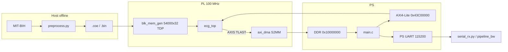

# Technical Design Specification: FPGA-Based Adaptive ECG Compression System

**Document:** Implementation-aligned revision (v3)  
**Base document:** `ECG_Design_Specv2.md`  
**Original outline:** `ECG_Design_Specification.md` (via v2)  
**Target Platform:** Zybo Z7-10 (Xilinx Zynq-7010 XC7Z010-1CLG400C)  
**Design Tools:** AMD Vitis HLS 2023.2 / Vivado Design Suite 2024.2 (implementation report) / Vitis 2023.2 (XSCT) / Python 3.11+ (`README.md`)

This revision preserves v2’s section numbering and headings so the two documents can be compared side by side. Text describes the behaviour that is actually implemented in the repository. New numbered sections after §12 are marked **[NEW]**.

**How to read status tags:** **Implemented** is in the deployed HLS/PS path; **Partially implemented** exists in Python and/or unused HLS constants; **Planned** is specified but not the live encoder; **Removed** was tried or specified and is no longer in the live path.

**Source of truth:** RTL/HLS (`hls/src/`), Python (`python/ecg_ref/`), scripts, configs, `data/reports/`, and comments in those files. v2 is only the outline. Where a number or rationale is not in the repo, this document says **not recorded** or **unverified**.

---

## 1. Executive Summary

This document is the engineering design specification for a real-time, FPGA-accelerated adaptive ECG compression system on the Zybo Z7-10 (XC7Z010-1CLG400C).

The compression engine is a hybrid dual-path scheme:

- **QRS Regions:** Lossless. 2nd-order linear predictor + adaptive Golomb-Rice with escape (`python/ecg_ref/lossless.py`, `hls/src/lossless.cpp`). Status: **Implemented**.
- **Non-QRS Regions (deployed):** Lossy. Adaptive-depth **LeGall 5/3** integer lifting DWT, dead-zone quantizer with frozen \(T=1\) ADU and \(a=1\) (so \(\Delta=1\)), method-(a) mirror boundaries, **cD1 discarded**, cA first-differences + per-sample Rice, detail bands (cD2…) zero-RLE + Rice (`python/ecg_ref/lossy_bw.py`, `python/ecg_ref/pipeline_bw.py`, `hls/src/lossy.cpp`). Status: **Implemented**.
- **Non-QRS Regions (legacy Haar, still in-tree):** 4-level reversible integer Haar, band hard thresholds, 16-bit RLE tokens (`python/ecg_ref/lossy.py`, `python/ecg_ref/pipeline.py`). Status: **Removed** from HLS/`serial_rx`; still used by `run_reference.py` / `verify_matrix.py` default scoring. See §25.
- **CDF 9/7 / bior4.4 lifting:** Integer Q19.6 × Q2.16 model remains in `lossy_bw.py` when `wavelet != "53"`. HLS comments still say “bior4.4”; the synthesised lift is 5/3 (`ecg_lift53_level` in `lossy.cpp`). Status: **Partially implemented** (Python optional; not the live HLS path).

Offline preprocessing (MIT-BIH MLII, 4th-order Butterworth 0.5–40 Hz, int16) runs on the host (`python/ecg_ref/preprocess.py`). The preprocessed record is loaded into on-chip BRAM via `*_x32.coe` at bitstream build or a packed `.bin` over JTAG (`vivado/create_bd.tcl`, `docs/hardware_bringup.md`).

The PL (`ecg_top` in `hls/src/ecg_top.cpp`) does two sequential passes: (1) detect R-peaks; (2) encode segments and pack onto AXI4-Stream. Detection uses a shift-based IIR, TKEO, MA \(L=18\), adaptive threshold, warmup, bidirectional peak search, and QRS windows \(R-29\ldots R+43\) (≤73 samples).

The PS arms AXI DMA into DDR, starts the core, times `ap_start`…`ap_done` with the A9 global timer, builds the 128-bit frame header from AXI4-Lite status, and sends the transport preamble plus frame on the **PS UART** (`ps/src/main.c`). `axi_uartlite` remains in the BD (`vivado/create_bd.tcl`) but firmware does not send the frame on Pmod JE1.

---

## 2. System Objectives & Design Constraints

### 2.1 System Objectives

- **Clinical Diagnostic Integrity:** QRS-region PRD exactly 0% (`config.TARGET_PRD_QRS`, `metrics.evaluate`). Overall PRD gate in `config.py` is still **baseline-inclusive PRD < 2%** (`TARGET_PRD_OVERALL = 2.0`, `PRD_GATE_METRIC = "baseline"`). Comments in `config.py` for the **deployed 5/3 path** state that record 222 is about **2.27% strict PRD** at \(T=1,a=1\), and that a 46-record \(a=1.25\) scan peaked at **2.41%**. A committed 46-record table for \(T=1,a=1\) is **not recorded**. Strict (zero-mean) PRD is always computed (`metrics.prd`).
- **High Compression Efficiency:** Target CR > 5 (`config.TARGET_CR`) on 5-minute MLII (108,000 samples). Haar-path published matrix (`README.md`, `docs/verification_matrix.md`) reports worst CR 5.29. That matrix is the **Haar** encoder (`pipeline.evaluate_record`), not the 5/3 hardware path. 5/3 / 9/7 Phase A/B JSON files record mean CR_full below 5 on some configurations (`results/phase_a/frozen.json`, `results/phase_b/decide.json`).
- **Deterministic Low Latency:** PS global timer around the core run; cycles reported in the UART preamble (`ps/src/main.c`).
- **Seamless Data Swapping:** `data/coe/<id>.bin` / `*_x32.coe`; JTAG write or COE rebuild without changing HLS sources (`vivado/create_bd.tcl`).
- **Hardware Resource Optimization:** Fit HLS IP + sample store in 60 BRAM36. Sample store is 54,000 × 32-bit TDP = 53 BRAM36; HLS coeff/peak memories use the rest. Implemented place: **60/60 BRAM36** (`data/reports/utilization_100.rpt`). Compressed output is DMA’d to DDR, not stored in a PL capture BRAM (capture buffer **Removed**; `lossy.cpp` count-then-emit).

### 2.2 Hardware & Platform Constraints

| Constraint           | Value                                                                                                   | Source |
| -------------------- | ------------------------------------------------------------------------------------------------------- | ------ |
| Target Device        | XC7Z010-1CLG400C on Zybo Z7-10                                                                          | `hls/tcl/common.tcl`, `vivado/build_vivado.tcl` |
| Block RAM            | 60 × 36 Kb; sample store 54000 × 32-bit words (two int16 per word)                                      | `create_bd.tcl`, `ecg_types.h` `ECG_N_BRAM_WORDS` |
| DSP48E1              | 80 available; implemented **10** used                                                                   | `data/reports/utilization_100.rpt` |
| Logic                | 17,600 LUT / 35,200 FF; implemented **15542 LUT (88.31%)**, **17941 FF (50.97%)**, **4400/4400 slices** | same report |
| HLS clock            | 10 ns period, **1.25 ns** uncertainty                                                                   | `hls/tcl/common.tcl` |
| Implemented timing   | WNS **+0.021 ns**, WHS **+0.020 ns** at 100 MHz                                                         | `data/reports/timing_100.rpt` (Vivado 2024.2, 13 Oct 2026) |
| Software toolchain   | Vitis HLS **2023.2**; Vivado used for the closed impl is **2024.2**; Vitis/XSCT **2023.2**; Python **3.11+** (`README.md`) | reports / README |
| Usable MIT-BIH set   | 46 MLII records (exclude 102, 104)                                                                      | `config.MLII_RECORDS` |

---

## 3. Hardware / Software Partitioning & Data Flow

> **Data ingest:** There is no live ECG stream into the FPGA. Samples sit in on-chip BRAM. AXI-Stream carries compressed **payload words only** from `ecg_top` to AXI DMA S2MM → HP0 → DDR. The PS prepends UART sync/length/latency and the 128-bit header (`ps/src/main.c`, `hls/src/ecg_top.h`). `axi_uartlite` is unused for frames.

### 3.1 Functional Partitioning

| Subsystem        | Environment                         | Responsibilities | Status |
| ---------------- | ----------------------------------- | ---------------- | ------ |
| Preprocessing    | Host (`python/ecg_ref/preprocess.py`) | MIT-BIH MLII, Butterworth 0.5–40 Hz `sosfiltfilt`, int16, `.coe`/`.bin` | Implemented |
| Real-time engine | PL `ecg_top`                        | Pass 1 detect; pass 2 5/3 lossy + lossless QRS + inline packer | Implemented |
| Control & ingest | PS `ps/src/main.c` + host `serial_rx` | DMA, start/status, UART frame, decode via `pipeline_bw.decode_from_bytes_bw` | Implemented |
| Haar reference scoring | `pipeline.py`, `verify_matrix.py` | Scores Haar CR/PRD, not the 5/3 bitstream | Partially implemented (not the HW decoder) |

---

## 4. Complete Processing Pipeline & Data Flow

```
┌──────────────────────────────────────────────────────────────┐
│ HOST LAPTOP (OFFLINE)                                         │
│ 1. Read MIT-BIH (.dat/.hea) -> Extract Lead MLII              │
│ 2. 4th-order Butterworth bandpass 0.5-40 Hz (sosfiltfilt)     │
│ 3. Quantize to int16 (200 ADU/mV gain ratio) ->               │
│    .coe / *_x32.coe / .bin / .dat                             │
└──────────────────────────────────────────────────────────────┘
                    │ (.coe at bitstream build, or JTAG .bin)
                    v
┌──────────────────────────────────────────────────────────────┐
│ ZYBO ZYNQ-7010                                                 │
│  On-chip TDP BRAM 54000 × 32, Enable_32bit_Address            │
│                    │ HLS PORTA, latency=2                      │
│  ecg_top: Pass 1 detect (IIR, TKEO, MA, thr, peak search)     │
│           Pass 2 encode: QRS Golomb-Rice / non-QRS 5/3+DZQ    │
│                    │ AXIS + TLAST                              │
│  axi_dma S2MM → smartconnect_hp → S_AXI_HP0 → DDR @ 0x10000000│
│  PS: header from status; PS UART 115200 8N1                   │
└──────────────────────────────────────────────────────────────┘
                    v
│ HOST: resync 0x45434731; decode pipeline_bw; score vs golden │
```

A Mermaid view of the same flow is in §14.

### Pipeline & Functional Module Specifications

### 4.1 Adaptive Detection & Segmentation Block

Status: **Implemented**. Sources: `python/ecg_ref/detect.py`, `hls/src/detect.cpp`, constants in `config.py` / `ecg_constants.h`.

Detection is a full-record pass that writes R-peak indices into `peaks[ECG_MAX_PEAKS]` (`ecg_top.cpp`). Compression is a second pass. BRAM is random-access; no streaming lookahead FIFO is required.

1. **Pre-Detection Bandpass:** First-order IIR from two power-of-two EMAs (`detect.iir_bandpass`, `ecg_iir_step`):
   - LP shift 1 → α = 1/2 → \(f_c \approx 39.7\) Hz (`config.py` comment)
   - HP shift 3 → α = 1/8 → \(f_c \approx 7.6\) Hz
   Accumulators carry `IIR_FRAC_BITS = 8`. Formula: `fc = -ln(1 - 2^-shift) * fs / (2*pi)` (`config.py`).
   HLS holds the packed BRAM word through `ecg_hold_u32` before IIR so the 53-tile dout mux is not in series with the IIR adders (`detect.cpp` detect_stream).
2. **TKEO:** \(\Psi[n] = x[n]^2 - x[n-1]x[n+1]\). Ends without a neighbour pair are 0. HLS: `ecg_tkeo` outlined, `BIND_OP` mul `impl=dsp latency=3` (combinational 32×29 mul was impl WNS ≈ −1.4 ns; comment in `detect.cpp`).
3. **Moving average:** Rectangular \(L = 18\), floor(\(sum/18\)). HLS uses reciprocal multiply-high via shared `ecg_mul_u32_dsp` / `ecg_smooth18` (combinational `mul_32ns_31ns_62_1_1` was WNS −0.635 ns).
4. **Adaptive threshold:** `thr_acc += asr(smooth<<THRESH_FRAC_BITS - thr_acc, THRESH_SHIFT)` with `THRESH_SHIFT=7` (÷128), `THRESH_FRAC_BITS=8`, `THRESH_INIT=0`.
5. **Warmup / trigger / refractory:** Suppress triggers for `THRESH_WARMUP=720` samples. Trigger when `smooth > THRESH_FACTOR * thr` (`THRESH_FACTOR=3`). Then `REFRACTORY=72`.
6. **Bidirectional peak search:** Largest `|sample|` in `[trigger-25, trigger+25]`, ties keep earliest index (`ecg_search_peak`). Sample is held via `ecg_hold_u32` after BRAM read (BRAM Tco + compare was WNS −1.94 ns).
7. **Window framing:** Nominal `QRS_PRE=29`, `QRS_POST=43`, `QRS_WINDOW=73`. Clamp to record; `start = max(R-29, prev_end+1, 0)` (`detect.frame_windows`, `ecg_frame_windows`, `ecg_encode_stage`).
8. **Non-QRS split:** Gaps (and leading/trailing) go to the lossy coder in chunks of at most `MAX_LOSSY_SEGMENT=2048` (`detect._emit_nonqrs`, `ecg_encode_stage`). Longest observed MIT-BIH gap cited as **1089 samples, record 124** (`config.py`); the cap is a buffer bound, not an active split on real data.

**Choice — IIR band ~7.6–39.7 Hz vs spec 1.8–7.2 Hz.** Reason recorded in `config.py`: filter is for region ID only; detection is scored against `.atr`. Alternative (spec band) not implemented.

**Choice — bidirectional ±25 search.** Reason recorded in `config.py`: MA delay vs leading-edge fire on a quiet baseline. Alternative (backwards-only) mis-centres windows.

### 4.2 Lossless Compression Block (QRS Regions)

Status: **Implemented**. `python/ecg_ref/lossless.py`, `hls/src/lossless.cpp`.

Applies to each QRS window of length \(L \le 73\):

1. **Predictor:** \(\hat{y}(n) = 2 y(n-1) - y(n-2)\) (`lossless.predict`, `ecg_predict`).
2. **Zigzag:** \(M(e)=2e\) if \(e\ge 0\), else \(-2e-1\) (`ecg_zigzag`).
3. **Adaptive \(k\):** Over residuals from index 2 onward, \(S=\sum M(e)\), \(k=\min(15,\max(0,\lfloor\log_2(S/N_{res})\rfloor))\). HLS implements the same without a general divider (`ecg_select_k`). \(k\) is sent in 4 bits.
4. **Escape:** If \(q=\lfloor M/2^k\rfloor \ge 31\), emit 31 ones (no terminator) then the raw 32-bit mapped value (`GR_Q_ESCAPE`, `GR_ESCAPE_BITS`).
5. Else unary \(q\) ones + 0 + \(k\) remainder bits.
6. Packet: tag 0, 16-bit length, 16-bit anchors, 4-bit \(k\), residual bits, align32 (`write_qrs_packet`, `ecg_encode_qrs`).

**Choice — copy window through one sequential BRAM port.** Reason in `lossless.cpp`: dual-port auto-pipeline left PORTB unwired; record 100 then used garbage anchors.

**Choice — do not pipeline the packed-word load.** Reason in `lossless.cpp`: even II=2 captured the previous word (QRS PRD ~55% on record 100).

### 4.3 Lossy Compression Block (Non-QRS Regions)

**Deployed path (Implemented):** LeGall 5/3 + dead-zone + Rice, not Haar.

Sources: `lossy_bw.py`, `pipeline_bw.py`, `hls/src/lossy.cpp`, `config.py` (`BW_*`).

1. **Depth \(L=\mathrm{l\_seg}(N)\):** Largest \(L\le L_{max}=5\) such that the next approximation length \((size+1)//2\) is still \(\ge 16\) (`BW_MIN_APPROX`). \(N<2\) or next approx would be \(<16\) → \(L=0\) (quantize samples as cA0). `ecg_bw_l_seg` / `l_seg_of`.
2. **Forward 5/3** on Q6 samples (`sample<<6`), method (a) (segment only; neighbour arguments ignored in HLS). Whole-sample symmetric reflection, edge not repeated (`ecg_reflect_idx`, `reflect_index`). Predict odds: \(d_i = x_i - \lfloor(x_{i-1}+x_{i+1})/2\rfloor\). Update evens: \(s_i = x_i + \lfloor(d_{i-1}+d_{i+1}+2)/4\rfloor\). Then split even/odd (`ecg_lift53_level`).
3. **cD1 is discarded** (never coded). Coding order: `cA_L`, then `cD_L` … `cD2` (`band_order`).
4. **Dead-zone quantizer:** \(T\) in Q6 = 64 (= 1 ADU), \(\Delta=1\) because \(a=1\). HLS: if \(|c|<T_{Q6}\) then 0 else \(\mathrm{sign}(c)\cdot\max(1,(|c|+32)>>6)\) (`ecg_dzq`). Matches `dzq_q` with `inv_d_q16=65536`.
5. **cA:** first differences then zigzag Rice, token-count prefix with \(k_{ntok}=4\). **Details:** RLE of zeros then Rice(run) + Rice(zigzag(level)). Per-band default \(k\) from `BW_RICE_K_TABLE` / `ecg_rice_k`. Per-segment reset.
6. **Packet (geometry unchanged from Haar’s 1+16+16 header):** `TAG_NONQRS | length[16] | rice_word_count[16] | align32 | rice words | align32` (`write_nonqrs_bw`, `ecg_encode_nonqrs`). Count-then-emit: Rice bits are counted first so the word-count field needs no capture BRAM (`lossy.cpp` comment: capture was 8 BRAM36).

**Haar path (Removed from hardware):** §4.3 of v2 (4-level S-transform, thresholds 24/64/64/160/160, 6+10-bit RLE tokens) still describes `lossy.py` / `pipeline.py`. HLS does not emit those tokens.

**CDF 9/7 (Partially implemented):** `lossy_bw._lift_level_int` and exported `ECG_BW_LIFT_*_Q16` constants. Not used when `BW_WAVELET="53"`.

**Method (b) QRS-neighbour extension (Partially implemented):** Python `encode_segment(..., method="b")` and `solve_method_b`. HLS zeros neighbour args. `BW_DEFAULT_METHOD = "a"`. Phase B `decide.json` recommended (a).

**Choice — 5/3 instead of 9/7.** Recorded in `config.py`: 9/7 Q16 lifting multipliers do not fit the XC7Z010 budget; 5/3 is add/shift. `decide.json` (older) said 5/3 at T=1 missed PRD≤2% (worst 2.504%); later comments freeze \(a=1\) and allow up to ~2.5% strict PRD. Alternatives tried: Haar (LUT/PRD), 9/7 (area).

**Choice — \(T=1\), \(a=1\).** Recorded in `config.py`: \(\Delta=1\) makes the quantizer a shift (no multiplier). Binding record 222 ~2.27% strict PRD.

**Choice — count-then-emit vs capture BRAM.** Recorded in `lossy.cpp` / conversation logs in comments: capture + sample store exceeded 60 BRAM36.

---

## 5. Hardware Interface Definitions & Register Map

### 5.1 Top-Level FPGA IP Interfaces

| Port Name | Direction | Protocol | Width | Description | Source |
| --------- | --------- | -------- | ----- | ----------- | ------ |
| `ap_clk` | In | Clock | 1 | 100 MHz FCLK_CLK0 | `create_bd.tcl` |
| `ap_rst_n` | In | Reset | 1 | Active-low `peripheral_aresetn` | same |
| `s_axi_ctrl` | In/Out | AXI4-Lite | 32 | `n_samples`, `status`, ap_ctrl | `ecg_top.cpp` pragmas |
| `ecg_bram` / `ecg_bram_PORTA` | In | BRAM ram_1p | 32 | Packed samples; `depth=ECG_N_BRAM_WORDS`, **latency=2** | `ecg_top.cpp` |
| `out_stream` | Out | AXIS | 32 + TLAST | Payload words to DMA S2MM | same |
| `interrupt` | Out | IRQ | 1 | Concatenated with DMA S2MM IRQ to IRQ_F2P | `create_bd.tcl` |

Reset values of AXI-Lite arguments: **not recorded** beyond HLS default (software writes `n_samples` before `ap_start`). `ap_ctrl` bits: start=0, done/idle/ready as HLS handshake (`xecg_top_hw.h`).

### 5.2 System Address Map (implemented)

| Region | Base | Range | Source |
| ------ | ---- | ----- | ------ |
| Sample store (AXI BRAM ctrl) | `0x40000000` | `0x40000` (256 KB hole; **used depth 54000 words / 216000 bytes**) | `create_bd.tcl`, `ps/src/ecg_hw.h` |
| AXI DMA S_AXI_LITE | `0x40400000` | `0x10000` | `create_bd.tcl` |
| `axi_uartlite` | `0x42C00000` | `0x10000` | `create_bd.tcl` (unused for frames) |
| `ecg_top` AXI4-Lite | `0x43C00000` | `0x10000` | `create_bd.tcl` |
| DDR frame buffer | `0x10000000` | 256 KB | `ecg_hw.h` `ECG_FRAME_BUFFER_*` |

HLS control map (`testing/drivers/ecg_top_v1_0/src/xecg_top_hw.h` / exported IP):

| Offset | Field | Reset / access |
| ------ | ----- | -------------- |
| 0x00 | ap_ctrl (start, done, idle, ready, auto_restart, interrupt) | HLS standard |
| 0x04 | GIE | 0 until software write (**unverified** default) |
| 0x08 | IER | same |
| 0x0c | ISR | TOW |
| 0x10 | `n_samples` [31:0] | software write |
| 0x20–0x30 | `status` 160 bits: word_count, qrs_count, checksum, peak_count, saturated | valid with 0x34 `status_ap_vld` |
| 0x34 | status_ap_vld | COR |

`ps/src/ecg_hw.h` maps status members at +0x00/+0x04/+0x08/+0x0C/+0x10 from `XECG_TOP_CTRL_ADDR_STATUS_DATA` (0x20 when generated header is used). Fallback `#define` of `STATUS_DATA` as 0x18 is only compiled if `xecg_top_hw.h` is absent.

### 5.3 UART Transport Framing (PS → host)

Not part of the compressed frame. Three big-endian words then the frame (`main.c`, `serial_rx.read_transport_frame`):

| Word | Content |
| ---- | ------- |
| 0 | Sync `0x45434731` (“ECG1”) |
| 1 | Frame length in 32-bit words (**header + payload**, not including this preamble) |
| 2 | Latency in PL cycles (A9 timer converted using `COUNTS_PER_SECOND` and `ECG_CLK_FREQ_HZ`) |

Then 4 header words + payload, all **big-endian**. DMA buffer in DDR is little-endian; firmware byte-swaps each word (`uart_send_word`). Banner text may precede the sync word.

---

## 6. Metadata & Bitstream Format

The PL streams **only payload packets**. The PS prepends the 128-bit header from status (`ecg_top.h`, `main.c`). Checksum is additive over payload words, init 0, mask `0xFFFFFFFF` (`packer.payload_checksum`, `ecg_bitpack_emit`).

### 6.1 128-Bit Top-Level Frame Header Layout

| Word | Bits | Field | Description |
| ---- | ---- | ----- | ----------- |
| 0 | [31:0] | Magic | `0xEC601001` (`MAGIC_WORD`) |
| 1 | [63:32] | Raw sample count | `n_samples` (e.g. 108000) |
| 2 | [95:64] | FS and QRS count | [15:0]=360, [31:16]=`qrs_count` |
| 3 | [127:96] | Checksum | Sum of payload words |

### 6.2 Segment Packet Payload Syntax

MSB-first packing (`packer.BitWriter`). Each packet ends with `align32`.

- **QRS (tag = 0):** `1 | 16 | 16 | 16 | 4 | Rice residuals | pad`. Fields: tag, length, y(0), y(1) (16-bit two’s complement), \(k\), then symbols as §4.2.
- **Non-QRS 5/3 (tag = 1):** `1 | 16 | 16 | align32 | word_count × 32-bit Rice words | align32`. The 16-bit third field is **Rice payload word count**, not Haar RLE symbol count. After the 33-bit header the stream is aligned so Rice data is whole words (`write_nonqrs_bw`).

v2’s “RLE symbol count + 16-bit tokens” describes the **Haar** packet only.

#### Worked byte-level example (QRS, length 2, no residuals)

Derived from §6.2 only (anchors only ⇒ \(k=0\), no residual loop). Let \(y(0)=1\), \(y(1)=-1\).

Bit order (MSB first): tag `0`, length `2` (16b), `0x0001`, `0xFFFF`, \(k=0\) (4b) = 53 bits; 11 pad bits → two words:

| Word | Value | Meaning |
| ---- | ----- | ------- |
| 0 | `0x00020000` | tag + length + high 15 bits of y(0) |
| 1 | `0xFFFF8000` | low bit of y(0), y(1), \(k\), pad |

A host `BitReader` recovers tag=0, length=2, anchors 1 and −1, \(k=0\). **Unverified on hardware** (constructed from the format; not a captured frame).

#### Worked non-QRS header (field layout only)

First 33 bits: tag `1`, length \(N\) (16b), `word_count` (16b), then zeros to a 32-bit boundary, then `word_count` Rice words. Example numerical Rice payload is **not recorded** here (depends on coefficients).

---

## 7. Performance Evaluation Metrics

Reconstruction is scored against the **preprocessed int16** BRAM contents (`preprocess.py` docstring; `metrics.evaluate`).

1. **CR:** \(CR = (N_{samples}\times 16)/B_{compressed}\) (`metrics.compression_ratio`). \(B\) is the compressed **frame** bit count (4-word header + payload). UART preamble is **not** included (`serial_rx.evaluate` uses `len(frame)*8` after stripping the preamble).
2. **PRD strict:** \(100\sqrt{\sum(x-\hat{x})^2/\sum x^2}\) (`metrics.prd`).
3. **PRD baseline-inclusive:** same numerator, denominator \(\sum(x+1024)^2\) (`MITBIH_ADC_ZERO`, `prd_baseline_inclusive`).
4. **PRD QRS / non-QRS:** same `prd` on the boolean mask from lossless packets.
5. **Gate in `config.py`:** CR > 5, gated PRD < 2% using `PRD_GATE_METRIC` (currently `"baseline"`), QRS PRD == 0, checksum OK (`Evaluation.passed`).
6. **Latency:** \(N_{cycles}/10^8\) s (`metrics.latency_seconds`); cycles from PS timer, not a PL register.
7. **Extra metrics (host-only):** PRDN1, MAX, PSim SDNN (`metrics.evaluate_quality`, `score_quality_metrics.py`). Not in the HLS status block.

**Haar 46-record published figures** (`README.md`, `docs/verification_matrix.md`): worst baseline PRD 1.66%, mean 1.07%, worst CR 5.29, QRS 0%. Those are **Haar** (`pipeline.evaluate_record`). They are **not** 5/3 hardware results.

**9/7 Phase A freeze** (`results/phase_a/frozen.json`): \(T=1\), \(a=1.8\), worst strict PRD 1.948% (record 222), mean CR_full 4.55, min CR_full 3.02.

**5/3 hardware freeze:** \(T=1\), \(a=1\) in `config.py`. Full 46-record CSV for that pair: **not recorded**. Comments: 222 ≈ 2.27% strict; \(a=1.25\) scan peak 2.41%. `decide.json` `best_53` 53_T1 worst 2.504% (quantizer \(a\) for that row is **not stated** in that object).

---

## 8. Vitis HLS Implementation & Testbench Architecture

### 8.1 Abbreviated Testbench Architecture

| TB | Top | Role |
| -- | --- | ---- |
| `hls/tb/tb_detect.cpp` | detect | triggers / peaks / traces vs golden |
| `hls/tb/tb_lossless.cpp` | encode_qrs_top | QRS packets |
| `hls/tb/tb_lossy.cpp` | encode_nonqrs_top | 5/3 packets vs `nonqrs_bw_words.txt` |
| `hls/tb/tb_packer.cpp` | packer | tokens / TLAST |
| `hls/tb/tb_top.cpp` | ecg_top | full frame vs `bitstream_words.txt` |

Golden dir: `data/golden/<id>/` from `run_reference.py --golden` (Haar intermediates **and** `pipeline_bw.write_golden_bw`). Native: `python hls/build_native.py`. Record id via Tcl `-tclargs` (`common.tcl`).

### 8.2 Vitis HLS Core IP Implementation Strategy

`ecg_top` is **two sequential passes**. DATAFLOW + token FIFO: **Removed** from the live top (`ecg_top.cpp` comments: BRAM budget + cosim deadlock). `TOKEN_FIFO_DEPTH=128` remains for module TBs.

Interfaces: BRAM `ram_1p` latency 2; s_axilite `n_samples`/`status`/return bundle `ctrl`; AXIS `out_stream`.

BRAM loads: `ecg_bram_load_word` INLINE off (`ecg_types.h`). QRS window copied to LUTRAM. Lossy `coeff_buf` / `coeff_scratch`: `ram_2p` BRAM, depth 2048 (`ecg_top.cpp`). Peaks: `ram_1p` BRAM, 1502 × 32 (`ECG_MAX_PEAKS`).

Packer: one `ecg_pack_op` instance; PK_PUT is a 3-phase loop so FSM decode + 32-bit add + (total−32) are not one combo path (`bitpack.cpp`). `ecg_hold_u32` is a 3-cycle register. Emit/Rice not pipelined (clones packer). `encode_nonqrs` kept INLINE at **one** call site (two sites duplicated pipelines; comment: 17630 LUT).

Clock: 10 ns, uncertainty 1.25 ns; `config_rtl -reset control` (`common.tcl`) to limit reset nets.

Csynth LUT estimates can exceed 17600 while Vivado Area_Explore places ~15542 (HLS estimate is pessimistic; last recorded csynth top LUT **unverified** in a committed report file — reproduce with `vitis_hls -f hls/tcl/top_integrate.tcl`).

Cosim may be skipped with `ECG_SKIP_COSIM`; export skip is a **separate** flag `ECG_SKIP_EXPORT` (`hls/tcl/top_integrate.tcl`).

---

## 9. Python Reference Implementation & Verification Strategy

`python/ecg_ref/` is the bitstream definition for the path each script actually calls.

1. **Preprocess:** `preprocess.py` as §4. Exports via `python/scripts/gen_coe.py`.
2. **Haar encoder/decoder:** `pipeline.py` — used by `run_reference.py` `analyse()`, `verify_matrix.py` `reference_row()`.
3. **5/3 encoder/decoder:** `pipeline_bw.py` / `lossy_bw.py` — used by HLS golden (`write_golden_bw`), `serial_rx.evaluate`, `phase_a_lossy_bw.py`, `phase_b_lossy_bw.py`.
4. **Host RX:** `python/scripts/serial_rx.py` decodes with `decode_from_bytes_bw` and compares `frame == golden.payload`. `testing/serial_rx.py` is a copy; `testing/ecg_ref` can lag `python/ecg_ref` (import of `pipeline_bw` failed when the kit snapshot was stale).
5. **Calibration leftover:** `calibrate_thresholds.py` / `BAND_THRESHOLD` apply to **Haar**, not 5/3 \(T,a\).

---

## 10. Verification & Testbench Architecture

Dataset swap: COE/golden + record id; core sources unchanged.

### 10.1 Comprehensive Verification Strategy

1. **Detection:** vs `.atr` within ±27 samples (`DETECT_TOLERANCE`, AAMI-style). Non-overlapping windows; short windows allowed.
2. **Lossless:** residual + zigzag + adaptive \(k\) + escape; QRS PRD 0 after decode.
3. **Lossy (deployed):** 5/3 + DZQ + Rice; `python/tests/test_lossy_bw.py`. Haar RLE continuation tests remain in older Haar tests.
4. **Packer:** 32-bit align, additive checksum, TLAST; transport tests `python/tests/test_transport.py`.
5. **Native C++:** `hls/build_native.py` vs golden words.

`docs/toolchain_gates.md` still describes DATAFLOW, 16-bit BRAM port B, and Haar verification_matrix numbers; those statements are **stale** relative to this repo (see §25).

### 10.2 Hardware Bring-Up Notes (implemented practice)

- JP5 = JTAG; one PROG USB @ 115200 (`docs/hardware_bringup.md`, `testing/testing steps.md`).
- Order: `loadhw` → `fpga` → A9#0 `stop` / `rst -processor` / `ps7_init` / `ps7_post_config` / `memmap` → optional `mwr -bin` → `dow` ELF → **start listener** → `con`.
- Strongest gate: frame **bit-identical** to `pipeline_bw.encode_record_bw` for that record.
- Rebuild ELF after a new XSA: `xsct ps/build_ps.tcl` from a Vitis 2023.2 command prompt at repo root.
- Full 46-record hardware identity on the **5/3** bitstream: **not recorded**.

---

## 11. Constants Single Source of Truth *(new)*

Shared numbers live in `python/ecg_ref/config.py`. `python/scripts/export_hls_constants.py` regenerates `hls/src/ecg_constants.h` (Haar band thresholds **and** 5/3 `ECG_BW_*`). PS includes that header (`ecg_hw.h`). After `config.py` changes, re-run the exporter (also invoked from `run_all.tcl`).

---

## 12. Change Log Relative to Original Spec *(new)*

v2’s table vs `ECG_Design_Specification.md` remains historically correct for the Haar-era design. Additional **v2 → v3 (repo now)** deltas are in §25.

| Topic | Original | v2 (Haar era) | Repo now |
| ----- | -------- | ------------- | -------- |
| Lossy wavelet | Haar \(\lfloor x/\sqrt{2}\rfloor\) | lifting Haar + band T | **LeGall 5/3** + DZQ \(T=1,a=1\) |
| Lossy packet body | RLE tokens | 6+10-bit RLE | **Rice words** after same 1+16+16 header |
| Vivado | 2023.2 | 2023.2 | Impl report **2024.2** |
| Multipliers | “none except TKEO” (README) | implied | TKEO + floor/18 on **DSP** |
| DATAFLOW | yes | abandoned | still abandoned |
| PRD gate | raw / 2% | baseline < 2% | `config` still baseline < 2%; 5/3 comments allow ~2.5% **strict** |

---

## 13. Notation and glossary **[NEW]**

| Symbol / name | Meaning | Value / rule | Source |
| ------------- | ------- | ------------ | ------ |
| \(f_s\), `FS` | Sampling rate | 360 Hz | `config.py` |
| \(N\), `N_SAMPLES` | Record length | 108000 | same |
| \(L\) (window) | QRS inclusive length | ≤73 | `QRS_WINDOW` |
| \(L\) (DWT) | Decomposition depth | 0…5 | `l_seg_of` |
| \(L_{max}\) | Cap on depth | 5 | `BW_L_MAX` |
| \(N\) (lossy) | Non-QRS segment length | 1…2048 | `MAX_LOSSY_SEGMENT` |
| \(T\) | Dead-zone threshold (ADU) | 1.0 frozen | `BW_DZ_T_FROZEN` |
| \(a\) | Dead-zone slope \(\Delta = a T\) | 1.0 frozen | `BW_DZ_A_FROZEN` |
| \(\Delta\) | Quantizer step | 1 at freeze | `make_quant_params` |
| `t_q6` | \(T\) in Q6 | 64 | `ECG_BW_DZ_T_Q6` |
| `inv_d_q16` | \(1/\Delta\) in Q0.16 | 65536 | `ECG_BW_DZ_INV_D_Q16` |
| \(k\) | Rice parameter | 0…15 | `GR_K_MAX` |
| \(q\) | Rice quotient | escape at 31 | `GR_Q_ESCAPE` |
| `K` (9/7) | CDF 9/7 scale | 1.230174104914001 | `BW_LIFT_K` (unused in 5/3 lift) |
| tag | Packet kind | 0 QRS, 1 non-QRS | `TAG_*` |
| Q6 / Q19.6 | Sample/coeff format | `<<6`, 25-bit sat | `BW_FRAC_DATA` |
| Q2.16 | 9/7 lift constants | unused in 5/3 | `BW_FRAC_CONST` |
| CR | Uncompressed bits / compressed frame bits | header included | `metrics.compression_ratio` |
| PRD strict / baseline | See §7 | | `metrics.py` |
| method (a)/(b) | Mirror vs QRS-neighbour DWT | default (a) | `BW_DEFAULT_METHOD` |
| M | Method-(b) margin | 32 | `BW_BND_MARGIN` (HLS unused) |

---

## 14. System architecture and data flow **[NEW]**



**Clocks:** Single PL clock `FCLK_CLK0` = 100 MHz to BRAM ctrl, `ecg_top`, DMA, UARTLite, both SmartConnects, GP0 and HP0 (`create_bd.tcl`). PS UART baud 115200 (`UART_BAUD`).

**Resets:** `FCLK_RESET0_N` → `proc_sys_reset_0` → `peripheral_aresetn` on those IPs.

---

## 15. Interfaces and register map **[NEW]**

Covered in §5 with offsets and widths. Additional buses:

| Bus | Role |
| --- | ---- |
| PS `M_AXI_GP0` → `smartconnect_ctrl` (1 SI / 4 MI) | ctrl, DMA lite, BRAM ctrl, UARTLite |
| DMA `M_AXI_S2MM` → `smartconnect_hp` → `S_AXI_HP0` | frame writes |
| `irq_concat` | DMA S2MM + `ecg_top` interrupt → `IRQ_F2P` |

DMA: simple mode, S2MM only, no SG, burst 16, 32-bit (`create_bd.tcl`). Firmware polls `ap_done` and DMA busy rather than using the IRQ (`main.c`).

---

## 16. Memory map **[NEW]**

| Memory | Size | Width | Who writes | Who reads | Lifetime |
| ------ | ---- | ----- | ---------- | --------- | -------- |
| Sample store `blk_mem_gen_0` | 54000 | 32 | COE / PS AXI @ 0x40000000 (port A) | `ecg_top` port B | Whole run; overwritten per record |
| `peaks[]` | 1502 | 32 | `ecg_detect_pass` | `ecg_encode_stage` | Pass 1 then pass 2 |
| `coeff_buf`, `coeff_scratch` | 2048 each | 32 (`ecg_coeff_t`) | `ecg_encode_nonqrs` | same | One lossy segment |
| QRS `window[]` | 73 | 16 | `ecg_encode_qrs` | same | One QRS |
| `s.ma_buf` | 18 | 64 | energy step | energy step | Detect stream; **LUTRAM** (`detect.cpp`) |
| DDR frame buffer | 256 KB | 8/32 | DMA S2MM | CPU after invalidate | One run |
| Packer `pending` | 1 word | 32 | packer | AXIS | Until finish (TLAST on last) |

**Choice — 54000 depth, Stand_Alone, byte-WE off.** IPI 256 KB aperture would become 65536×32 = 64 BRAM36 (illegal). Byte-WE tiles 512 words/BRAM36 (106 blocks). Comments in `create_bd.tcl`. `Enable_32bit_Address` true: otherwise byte addresses are used as word indices (record 100 ~877 peaks).

**Choice — no payload capture BRAM.** Sample store already ~53 BRAM36.

---

## 17. Packet and bitstream format **[NEW]**

See §6. Ordering: packets in time order covering every sample exactly once (`detect.build_segments`). Decoder concatenates (`decode_from_bytes_bw`). Escape codes: Rice \(q\ge 31\) as §4.2/§4.3. Haar continuation token `(63,0)` applies only to the legacy Haar RLE path.

---

## 18. Algorithms **[NEW]**

### 18.1 Detection (bit-exact Python ↔ HLS)

```
lp_acc += asr((x<<8) - lp_acc, 1);  lp = asr(lp_acc, 8)
hp_acc += asr((lp<<8) - hp_acc, 3);  bp = lp - asr(hp_acc, 8)
psi = 0 if edge else bp[n]^2 - bp[n-1]*bp[n+1]
ma_sum += psi - ma_buf[i];  sm = floor(ma_sum / 18)
thr_acc += asr((sm<<8) - thr_acc, 7);  thr = asr(thr_acc, 8)
trigger if index>=720 and refractory==0 and sm > 3*thr
apex = argmax |sample| on [trig-25, trig+25]
window = [max(R-29, prev_end+1, 0), min(R+43, N-1)]
```

HLS detect_stream runs one extra iteration past \(N\) so TKEO at \(N-1\) can be scored (`detect.cpp` comments). `detect.py` TKEO is vectorised over the whole array (same zeros at ends).

### 18.2 Lossless

See §4.2. Empty window: Python raises; HLS is not given length 0 from framing.

### 18.3 Lossy 5/3 (deployed)

```
L = l_seg(N)
x_q6[i] = sample[i] << 6
for lv in 0..L-1: lift53 in-place (odds then evens), keep low half
quantize all but cD1 with dzq
rice_bits = count(cA DPCM Rice + detail RLE Rice)
word_count = ceil(rice_bits / 32)
emit tag=1, N, word_count, align32, emit Rice, align32
```

Host inverse: dequant \(q\cdot\Delta\) (\(\Delta=1\)), insert zeros for cD1, inverse 5/3 (`dwt_inverse_lin` / `_inv_level_53_lin`), take first \(N\) samples (`reconstruct_segment` method a).

### 18.4 Host decoder

`decode_from_bytes_bw`: parse header; walk tags until `sample_count` samples; QRS via `decode_qrs`; non-QRS via `decode_subband` then `reconstruct_segment`. Neighbours for method (a) are unused.

---

## 19. Numeric formats and constants **[NEW]**

| Item | Format / value | Source |
| ---- | -------------- | ------ |
| Stored sample | int16, clip [−32768, 32767] | `quantize` |
| IIR / filt | int32 + 8 frac bits | `ecg_filt_t` |
| TKEO / MA | int64 | `ecg_energy_t` |
| 5/3 sample in DWT | Q6, sat 25-bit [−2²⁴, 2²⁴−1] | `sample_to_q6`, `sat25` |
| DZQ | see §4.3 | `ecg_dzq` |
| Rice \(k\) table | cA0..cA5: (0,4)…(0,7); cD2..cD5: (1,0),(0,2),(0,3),(0,5) | `BW_RICE_K_TABLE` |
| Haar T / shifts | 24/64/64/160/160 and all shifts 0 | still in `ecg_constants.h`; **unused by HLS lossy** |
| 9/7 Q16 constants | exported; **unused by `ecg_lift53_level`** | `ecg_constants.h` |

Rounding: preprocess `np.rint`; 9/7 mul_q16 round-nearest (unused in 5/3); 5/3 uses floor via arithmetic shifts; DZQ `(|c|+32)>>6` is round-nearest of \(|c|/64\).

---

## 20. Control and state machines **[NEW]**

**`ecg_top`:** `ecg_detect_pass` (triggers then `refine_peaks`) → `ecg_encode_stage` (walk cursor; QRS or lossy chunk) → `ecg_bitpack_finish`.

**`ecg_encode_stage`:** Find first valid window; while `cursor < total`: if at QRS start encode QRS and advance peak; else encode `min(gap, 2048)` non-QRS.

**`ecg_pack_op` PK_PUT:** phase 0 latch args; phase 1 `total = count+nbits`; phase 2 carry/remainder/shift (`bitpack.cpp`). Other ops: COUNT, FINISH, WORDS, CKSUM.

**PS `run_once`:** cache flush → `XAxiDma_SimpleTransfer` → start core → poll done → poll DMA → read status → cache invalidate → print banner → quiet window: preamble + header + payload → `done`.

---

## 21. Timing and throughput **[NEW]**

| Item | Recorded fact |
| ---- | ------------- |
| PL clock | 100 MHz, HLS uncertainty 1.25 ns |
| Closed impl | WNS +0.021 ns, WHS +0.020 ns (`timing_100.rpt`) |
| detect_stream II | **PIPELINE off**; csynth iteration latency last seen **48 cycles** / 108001 trips (**unverified** unless you re-open `csynth.rpt`) |
| TKEO | 3-cycle DSP muls |
| `ecg_hold_u32` | 3 cycles |
| `ecg_mul_u32_dsp` | 3-cycle; mulhi 2×2 loop |
| Real-time headroom | Comments in `detect.cpp`: serial detect is ≫ 360 Hz; exact cycles/sample for the closed bitstream **not recorded** in a committed latency file |
| Max lossy segment | 2048 samples (coeff BRAM) |
| UART vs core | `create_bd.tcl`: UART ~10⁴ slower than the core; DMA staging so latency is not baud-limited |

Post-route leftover before TNS-cleanup was SmartConnect → PS `SAXIHP0AWSIZE` (route, not ECG combo). `build_vivado.tcl` unroutes violators and `route_design -tns_cleanup`. HP pblock `SLICE_X0Y0:SLICE_X9Y49` in `vivado/constraints/ecg_zybo.xdc`.

---

## 22. Resource utilization **[NEW]**

From `data/reports/utilization_100.rpt` (Vivado 2024.2, routed, record-100 COE build):

| Resource | Used | Avail | Util% |
| -------- | ---- | ----- | ----- |
| Slice LUT | 15542 | 17600 | 88.31 |
| LUT as logic | 14214 | 17600 | 80.76 |
| LUT as memory | 1328 | 6000 | 22.13 |
| FF | 17941 | 35200 | 50.97 |
| Slice | 4400 | 4400 | 100.00 |
| Control sets | 894 | 4400 | 20.32 |
| BRAM36 | 60 | 60 | 100.00 |
| DSP48E1 | 10 | 80 | 12.50 |

**Constraints / strategy:** `Flow_AreaOptimized_high` synth; `Area_Explore` impl; `ExploreArea` opt; place Default; pre-route phys_opt Explore; **post-route phys_opt disabled** in the run (marks Failed when WNS stays slightly negative); in-script TNS-cleanup (`vivado/build_vivado.tcl`). Part `xc7z010clg400-1`. Clock 10 ns (PS FCLK 100 MHz). HLS uncertainty 1.25 ns does not appear as an XDC uncertainty of 1.25 ns on the PS path (timing report clock uncertainty 0.154 ns on the closed HP0 path).

`docs/resource_budget.md` “57 of 60” is **stale** vs this report.

---

## 23. Verification **[NEW]**

| Layer | How | Status |
| ----- | --- | ------ |
| Python unit | `pytest python/tests` including `test_lossy_bw.py` | Implemented; pass count in `toolchain_gates.md` (134) is **unverified** now |
| Golden encode | `run_reference.py --golden` writes Haar + BW files | Implemented |
| Native C++ | `hls/build_native.py` | Implemented |
| HLS csim/csynth | `hls/tcl/run_all.tcl` | Implemented |
| Cosim | optional skip | Partially implemented as a gate |
| Host loopback | `serial_rx.py --loopback` | Implemented (uses 5/3 decoder) |
| Board identity | `serial_rx` `matches_golden` | Method Implemented; 5/3 population result **not recorded** |

---

## 24. Evaluation method **[NEW]**

**Dataset:** `config.MLII_RECORDS` (46 IDs). First `N_SAMPLES` from `RECORD_START=0`. Lead `MLII`.

**Metrics:** §7 as implemented in `metrics.py`.

**Which encoder a script uses:**

| Script | Encoder |
| ------ | ------- |
| `verify_matrix.py --mode reference` | Haar `pipeline.evaluate_record` |
| `run_reference.py` printed table | Haar |
| `run_reference.py --golden` | Haar files + **5/3** `bitstream_words.txt` |
| `serial_rx.py` / `capture_all.py` | 5/3 decode + 5/3 golden compare |
| `phase_a_lossy_bw.py` / `phase_b_lossy_bw.py` | 5/3 / 9/7 sweeps |
| `docs/verification_matrix.md` | Haar (stale vs hardware) |

**Per-record 5/3 \(T=1,a=1\) summary table:** **not recorded** in-repo. Phase A/B JSON describe 9/7 \(T=1,a=1.8\) and a 5/3 T=1 row with worst PRD 2.504% (`results/phase_b/decide.json`).

**Hardware captures:** `captures/capture_*.meta.json` exist; whether they match the current 5/3 bitstream is **unverified** (old Haar kit bits also sit under `testing/`).

---

## 25. Reproduction **[NEW]**

**Environment (recorded):**

- Python 3.11+ (`README.md`); `pip install -r requirements.txt`
- Vitis HLS 2023.2: `C:\Xilinx\Vitis_HLS\2023.2\bin\vitis_hls.bat` (path used in this repo’s flow)
- Vivado **2024.2** produced `timing_100.rpt` / `utilization_100.rpt` (`C:\Apps\Vivado\2024.2` in this tree’s build scripts)
- Vitis / XSCT 2023.2 for `xsct ps/build_ps.tcl`
- Digilent Zybo Z7-10 board files required (`build_vivado.tcl`)

**Regenerate constants and golden:**

```bat
cd C:\Users\elina\Moved_files\Capstone\ECG_Code
python python/scripts/download_mitdb.py
python python/scripts/gen_coe.py
python python/scripts/export_hls_constants.py
python python/scripts/run_reference.py 100 --golden
python hls/build_native.py --records 100
```

**HLS IP:**

```bat
set ECG_SKIP_COSIM=1
vitis_hls -f hls/tcl/top_integrate.tcl
```

Do not set `ECG_SKIP_EXPORT` if Vivado needs a fresh IP.

**Vivado (deletes `vivado/proj_ecg`):**

```bat
vivado -mode batch -source vivado/build_vivado.tcl
```

Produces `vivado/ecg_zybo.xsa` and `vivado/proj_ecg/ecg_zybo.runs/impl_1/ecg_system_wrapper.bit` if WNS ≥ 0 after TNS-cleanup.

**PS ELF:**

```bat
xsct ps/build_ps.tcl
```

from a **Vitis 2023.2 Command Prompt**, cwd = repo root. Output: `ps/workspace/ecg_app/Debug/ecg_app.elf`.

**Board (after ELF):** start `python python/scripts/serial_rx.py --port COMx --record 100` first, then XSDB as in `testing/testing steps.md`. Use `python/scripts/serial_rx.py` (not a stale `testing/ecg_ref`).

**Haar matrix (not HW):** `python python/scripts/verify_matrix.py`

**5/3 sweeps:** `python python/scripts/phase_a_lossy_bw.py`, `phase_b_lossy_bw.py`

---

## 26. Known limitations, discrepancies with v2, and open questions **[NEW]**

### 26.1 Known limitations

- Slice occupancy 100%; HP0 routing is tight; TNS-cleanup is part of the build.
- CR > 5 on **every** 5/3/9/7 record is not claimed (`decide.json` `gate_cr5_every_record: false`); lossless QRS dominates dense-QRS bit budgets.
- `config.PRD_GATE_METRIC` / `TARGET_PRD_OVERALL` still describe a 2% **baseline** Haar-era gate; deployed 5/3 comments describe ~2.5% **strict** on the binding record.
- Haar scoring scripts will not match a 5/3 board frame.
- `testing/ecg_ref` can omit `pipeline_bw` (ImportError).
- Firmware must not `xil_printf` during the payload (`main.c`).
- Method (b) and 9/7 lift are not in the live HLS encoder.
- Cosim is not required for a bitstream if `ECG_SKIP_COSIM=1`.

### 26.2 Discrepancies with v2

| v2 statement | Repo now |
| ------------ | -------- |
| Lossy = 4-level Haar + band T + 16-bit RLE | HLS/host RX = 5/3 + DZQ + Rice; Haar remains only in `pipeline.py` |
| Non-QRS packet = RLE symbol count + tokens | Third 16-bit field = Rice **word** count; body is 32-bit Rice words |
| Vivado Design Suite 2023.2 | Closed impl reports Vivado **2024.2** |
| Python 3.10+ | README: **3.11+** |
| DMA address “BSP device ID” only | DMA lite also at **0x40400000**; UARTLite **0x42C00000** |
| PRD gate baseline < 2% as the HW story | `config.py` still says that; 5/3 freeze comments use ~2.5% strict |
| “No multipliers except TKEO” (README, implied) | DSP muls for TKEO and floor/18 |
| Short non-QRS as raw samples if `<16` (v2 §12 note: padded Haar) | 5/3: \(L=0\) codes samples as **cA0** Rice, not a raw-sample tag |
| DATAFLOW discussed as abandoned (agree) | Agree; `toolchain_gates.md` still talks as if DATAFLOW is the risk |
| Sample store “16-bit port B” in old gates doc | Both ports **32-bit** |
| BRAM budget ~53 + HLS small | Place uses **60/60** |
| Host decoder Golomb + inverse Haar | `serial_rx` uses `pipeline_bw` |
| `ecg_top.cpp` comment “mirrors pipeline.py” | Encode stage mirrors **pipeline_bw** / `lossy.cpp` for non-QRS |

### 26.3 Open questions

1. Committed 46-record CR/PRD table for **5/3, \(T=1\), \(a=1\)** — **not recorded**. What would verify: `phase_a`/`encode_record_bw` over `MLII_RECORDS` written to `results/`.
2. Board **BIT-IDENTICAL** on record 100 (and 46-record hardware) for the closed 5/3 bitstream — **not recorded**.
3. Exact detect/encode **cycles per sample** on the closed netlist — **not recorded** (csynth iteration 48 was seen in a session log).
4. Whether last IP export included **cosim** — **not recorded** (`ECG_SKIP_COSIM` is available).
5. Current `pytest` count — `toolchain_gates.md` says 134; **unverified**.
6. `PRD_GATE_METRIC` vs the 2.5% strict allowance — config and comments disagree; which is the official gate is **not recorded** as a single updated constant.
7. Reset defaults of AXI-Lite GIE/IER — **not recorded**.
8. Whether `captures/*.meta.json` were produced with Haar or 5/3 — **unverified**.
9. `decide.json` still recommends 9/7 and method (b) as “current HLS”; that file is **stale** vs `lossy.cpp`.

---

## 27. Design-choice register **[NEW]**

| Choice | Value | Alternatives recorded | Reason (evidence) | Code |
| ------ | ----- | --------------------- | ----------------- | ---- |
| Dual-path QRS/non-QRS | lossless / lossy | not recorded as tried single-path | clinical QRS PRD 0 (`config` comments) | `pipeline_bw`, `ecg_top` |
| Detector | TKEO+MA not Pan-Tompkins on PL | `pan_tompkins.py` exists for quality metrics only | not recorded for rejecting PT on PL | `detect.py` |
| IIR band | ~7.6–39.7 Hz | spec 1.8–7.2 Hz | region ID; `.atr` validation (`config.py`) | `IIR_*` |
| Peak search | ±25 both ways | backwards-only | leading-edge fire (`config.py`) | `ecg_search_peak` |
| QRS window | 73 = R−29…R+43 | original 72 | inclusive span (`config.py`) | `QRS_*` |
| Warmup | 720 | none | thr starts at 0 (`config.py`) | `THRESH_WARMUP` |
| Lossy wavelet | 5/3 | Haar; 9/7 | area vs PRD (`config.py`, `decide.json`) | `lossy.cpp` |
| \(T,a\) | 1, 1 | 9/7 \(a=1.8\); \(a=1.25\) scan | shift quantizer; 222 PRD (`config.py`) | `BW_DZ_*` |
| Method | (a) mirror | (b) + M=32 | HLS simplicity; `decide.json` CR/PRD | `encode_nonqrs` ignores neighbours |
| Drop cD1 | yes | keep cD1 | brief/model (`lossy_bw.quantize_bands`) | `lossy.cpp` |
| cA coder | DPCM+Rice | RLE on cA | `BW_CA_DPCM=True`, `BW_CA_RLE=False` | `encode_subband` |
| Rice \(k\) | frozen table | forward-selected \(k\) | `decide.json` (4-bit field cost) | `ecg_rice_k` |
| Max lossy \(N\) | 2048 | full 108000 buffer | BRAM (`config.py`) | `ECG_MAX_LOSSY_SEGMENT` |
| Packet 1+16+16 | kept | new header | comment: geometry unchanged | `write_nonqrs_bw` |
| No capture BRAM | count-then-emit | 8 BRAM36 capture | BRAM budget (`lossy.cpp`) | `ecg_encode_nonqrs` |
| Two-pass top | detect then encode | DATAFLOW+FIFO | BRAM + cosim deadlock (`ecg_top.cpp`) | `ecg_top` |
| Inline pack | yes | token FIFO 128 | same | `ecg_coder_pack` |
| BRAM 32-bit TDP | 54000×32 | 16-bit B; 64k depth | Vivado TDP / 64 BRAM36 (`create_bd.tcl`) | BD |
| Output via DMA+PS UART | yes | UARTLite JE1 | one cable; UART back-pressure (`create_bd.tcl`, `main.c`) | `main.c` |
| Header in PS | yes | header in PL | checksum needs full payload (`ecg_top.h`) | `main.c` |
| Area_Explore | yes | Performance_* | Place 30-487 at 802 CSets (`build_vivado.tcl`) | impl strategy |
| Hold BRAM/IIR/TKEO/energy | multi-cycle | combo | WNS comments in `detect.cpp` | `detect.cpp` |
| Packer 3-phase PUT | yes | 1-cycle add+sub | WNS −2.04 on `sub_ln124` (comment) | `bitpack.cpp` |

If a reason is only in chat and not in the tree, it is omitted (this table cites files only).

---

*End of implementation-aligned specification v3.*
