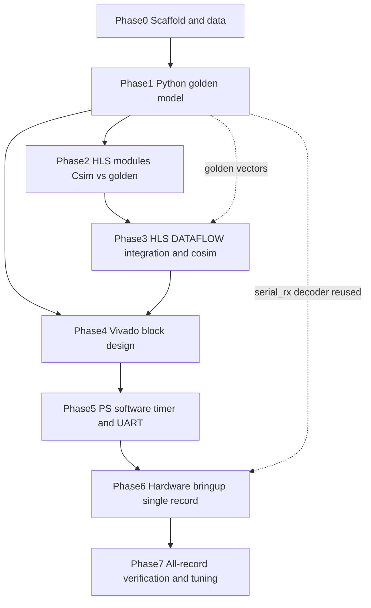

# FPGA Adaptive ECG Compression — End-to-End Execution Plan

Greenfield build. Repo currently holds only [ECG_Design_Specification.md](ECG_Design_Specification.md) and [Zybo-Z7-Master.xdc](Zybo-Z7-Master.xdc). Core strategy: **make the Python reference model the single source of truth**, emit golden intermediate vectors from it, and gate every HLS/hardware step against those vectors so debugging happens in numpy (fast) rather than co-sim/hardware (slow).

## Resolved spec decisions (locked with you)

- RLE token = `[6-bit run (0-63) | 10-bit signed value]`; runs > 63 emit a continuation tuple `(63, 0)`. Section 10.1 test is corrected to ">63 zeros".
- QRS window = 73 samples inclusive (`R-29 .. R+43`); `WS = 73` in the Golomb divisor and all buffers.
- Rice parameter `k = max(0, floor(log2(S/WS)))`, `S = Σ M(e)` over mapped residuals; the Section 4.2 pseudocode is treated as informal.
- Records = MLII-bearing MIT-BIH records only (skip 102 and 104), first 108,000 samples (0..107,999) of each.

## Proposed defaults for still-underspecified items (documented, not blocking — veto anytime)

- **PRD baseline**: PRD/CR are measured against the **16-bit quantized signal loaded into BRAM** (the FPGA never sees pre-quantization floats), so "PRD=0% on QRS" is exact reconstruction of that int16 signal.
- **Quantization**: filtered float -> int16 via a single `QUANT_GAIN` (+ optional offset) in `config.py`, chosen so max |sample| stays inside int16 with headroom; identical constant used in `.coe` generation and PRD reference.
- **Pre-detection IIR (resource-minimized, per your direction)**: this filter only supports region identification (final QRS boundaries come from the later TKEO/threshold stages), so no Butterworth is needed. Use a **first-order IIR bandpass** = cascade of a 1st-order low-pass (cutoff ≈ fs/8 = 45 Hz) and a 1st-order high-pass (cutoff ≈ fs/32 ≈ 11.25 Hz). Power-of-two cutoffs let the coefficient be a shift, so it maps to shifts/adds with **no DSP48 usage**. NOTE: this replaces the spec's 1.8-7.2 Hz passband with ~11.25-45 Hz; acceptable because detection is validated against `.atr`, not against a fixed band. The same quantized coefficients are used in Python and HLS.
- **Haar 1/√2**: fixed integer constant `INV_SQRT2 = round(2^15/√2) = 23170`, transform via `(x0±x1)*23170 >> 15` with arithmetic-shift floor semantics, identical in Python and HLS. Inverse uses the same constant (path is lossy; drift is bounded and counted in PRD).
- **4-level DWT segmentation**: non-QRS runs are variable length; pad each segment up to a multiple of 16 (record pad length in the segment metadata) so 4 decomposition levels are always valid.
- **10-bit coefficient field**: define an explicit clip/scale rule for DWT coefficients into signed 10-bit (`-512..511`); log clip events during Phase 1 tuning.
- **Frame checksum**: define a concrete 32-bit checksum (e.g. XOR/CRC32 of payload words); decoder validates it.
- **Band thresholds are global, not per-record (per your direction)**: pick a single `{T_A4, T_D_LOW, T_D_HIGH}` set that is best across the whole record population, then freeze it in `config.py`. No per-record tuning — the deployed constants are fixed for all 45 records.

## Proposed repo structure

```
ECG_Code/
  python/ecg_ref/{config,preprocess,detect,lossless,lossy,packer,pipeline,metrics,fixedpoint}.py
  python/scripts/{download_mitdb,gen_coe,run_reference,serial_rx}.py
  python/tests/test_{preprocess,detect,lossless,lossy,packer,roundtrip}.py
  data/{mitdb/ (raw, gitignored), coe/, golden/}
  hls/src/{ecg_types.h, ecg_top.{h,cpp}, detect.{h,cpp}, lossless.{h,cpp}, lossy.{h,cpp}, packer.{h,cpp}, bram_wrapper.h}
  hls/tb/{tb_detect,tb_lossless,tb_lossy,tb_packer,tb_top}.cpp
  hls/tcl/{run_all.tcl, module_detect.tcl, module_lossless.tcl, module_lossy.tcl, module_packer.tcl, top_integrate.tcl}  (vitis_hls -f driven: csim/csynth/cosim/export)
  vivado/{gen_bd_from_gui.tcl (exported via write_bd_tcl), build_vivado.tcl, constraints/}
  ps/src/main.c   (bare-metal Cortex-A9: AXI-Lite ctrl, global timer latency, DMA->UART)
  docs/verification_matrix.md
  requirements.txt  README.md
```

## Dependency / sequencing overview




Parallelizable: Phase 4 skeleton (PS block, clocking, BRAM, DMA, UART pinout) can start right after Phase 1 using a stub/black-box IP, in parallel with Phases 2-3. PS software (Phase 5) UART/timer plumbing can be prototyped against the stub too. Strictly sequential: P1->P2->P3 (each gates the next), and real IP integration into Vivado needs P3's exported IP.

---

## Phase 0 — Scaffolding & data acquisition

- Tasks: create repo layout, `requirements.txt` (numpy, scipy, wfdb, pyserial, matplotlib, pytest), `README`, `.gitignore` (raw data). `download_mitdb.py` fetches records + `.atr` annotations. Centralize every constant in `config.py` (fs=360, WS=73, R-29/R+43, L=18, refractory=72, threshold factor 3, /128 update, band thresholds 80/120/200, INV_SQRT2, QUANT_GAIN, magic `0xEC601001`).
- Inputs: spec. Outputs: runnable skeleton, one downloaded/parsed record.
- Files: `config.py`, `download_mitdb.py`, `requirements.txt`.
- Verify: `pytest` collects; record 100 parses and MLII channel is identified.

## Phase 1 — Python reference model (golden source of truth) [most valuable phase]

Build and unit-test each stage in numpy, then dump golden intermediate vectors for HLS.

- 1a Preprocess (`preprocess.py`): read `.dat/.hea`, select MLII, 4th-order Butterworth 0.5-40 Hz, quantize int16, write `.coe`/`.dat`. Verify: filter magnitude response sane; `.coe` round-trips back to identical int16 array; length == 108,000.
- 1b Detection/segmentation (`detect.py`): first-order IIR bandpass (LP ≈ fs/8, HP ≈ fs/32, shift-based coefficients), TKEO, L=18 moving average, adaptive threshold, `>3x` peak flag, 72-sample refractory, 73-sample window framing + lossy/lossless routing. Verify: detected R-peaks vs `.atr` annotations (sensitivity/PPV within tolerance) — this is what validates the chosen filter band; **consecutive-beat test** at high HR confirms windows never truncate/overlap incorrectly.
- 1c Lossless (`lossless.py`): 2nd-order predictor, zigzag map `M(e)`, adaptive `k`, Golomb-Rice encode + decode. Verify: **encode∘decode == identity** on QRS windows (PRD=0); edge cases — all-zero residuals (S=0 -> k=0, no log2(0)), max-amplitude residuals (no overflow), single-sample and boundary windows.
- 1d Lossy (`lossy.py`): 4-level Haar DWT (fixed-point), band thresholding, RLE encode/decode, inverse DWT. Verify: forward/inverse DWT drift bounded; threshold zeroing correct per band; **RLE >63-zero run emits** `(63,0)` **continuation** and decodes exactly; 10-bit clip rule exercised; non-multiple-of-16 segment padding round-trips.
- 1e Packer (`packer.py`): bit-level writer/reader, 128-bit header, tagged QRS/non-QRS packets, 32-bit padding, TLAST semantics, checksum. Verify: header fields decode; every packet 32-bit aligned; full-stream reader reconstructs segment boundaries.
- 1f Pipeline + metrics (`pipeline.py`, `metrics.py`): full encode->bitstream->decode->reconstruct; CR and PRD (overall + QRS-only). Emit golden vectors to `data/golden/<rec>/` (post-preprocess int16, TKEO/threshold traces, per-segment residuals, k values, DWT coeffs, final bitstream).
- 1g Fixed-point mirror (`fixedpoint.py`): integer/fixed helpers that mirror `ap_int`/`ap_fixed` truncation & shift semantics so Python == HLS exactly.
- 1h Global threshold calibration (`scripts/calibrate_thresholds.py`): sweep `{T_A4, T_D_LOW, T_D_HIGH}` over the aggregate of **all** records, pick the single set maximizing CR subject to overall PRD<2% (and PRD=0% QRS, which is threshold-independent), then freeze those three constants into `config.py`. Run once; the result is fixed for every record and every downstream phase. Verify: chosen set meets targets on the full population, not just record 100.
- Inputs: Phase 0 config + data. Outputs: frozen global thresholds; golden vectors + `.coe` for all records; `run_reference.py` report.
- Verify (phase gate): with the frozen global thresholds, record 100 achieves **PRD=0% on QRS, overall PRD<2%, CR>5:1**, and full round-trip identity of the decoder.

## Phase 2 — HLS module development (C-simulation vs golden)

Port each module to C++ with HLS types; each testbench loads golden inputs and asserts **bit-exact** equality to golden outputs. **All HLS work is Tcl-automated** — no manual GUI clicking.

- Tasks: `ecg_types.h` (typedefs matching `fixedpoint.py`), then `detect`, `lossless`, `lossy`, `packer` `.cpp/.h` + `tb_*.cpp`. `bram_wrapper.h` reads `.coe` into a simulated BRAM array (file-swappable per Section 8.1).
- Automation: one `module_<name>.tcl` per module (`open_project`, `add_files`/`add_files -tb`, `set_top`, `create_clock`, `csim_design`, `csynth_design`), plus `run_all.tcl` that loops all modules; invoked headless as `vitis_hls -f hls/tcl/run_all.tcl`. CI-friendly: exits non-zero on any csim assertion failure.
- Inputs: golden vectors, `.coe`. Outputs: C-sim-passing modules; per-module synth reports.
- Verify: per-module `csim` bit-exact vs golden for record 100 (and 3-4 diverse records: fast HR, noisy, paced-free), driven entirely by Tcl. Re-run Phase-1 edge cases as HLS asserts (Golomb k, RLE overflow, DWT drift).

## Phase 3 — HLS integration, DATAFLOW & co-simulation

- Tasks: `ecg_top.cpp` wiring modules with `#pragma HLS DATAFLOW` + `hls::stream<>` FIFOs; interface pragmas (`bram` for `ecg_bram_port`, `s_axilite` for control, `axis` for `out_stream`/`tlast`). Tune FIFO depths; `csynth`; `cosim`; export IP. Driven by `hls/tcl/top_integrate.tcl` (adds `cosim_design` and `export_design -format ip_catalog`), runnable headless via `vitis_hls -f`.
- Inputs: Phase 2 modules, golden bitstream. Outputs: exported IP-XACT core, timing/latency + resource reports.
- Verify: top-level `csim` bit-exact to golden bitstream; `cosim` RTL-vs-C match; **no DATAFLOW deadlock/stall**; latency report captured; **BRAM/DSP/LUT/FF within budget** (60 BRAM incl. the ~1.73 Mb sample store + FIFOs/coeffs; 80 DSP; 17.6k LUT; 35.2k FF).

## Phase 4 — Vivado block design (parallelizable early with stub)

- Approach (confidence-driven): **build the block design once in the Vivado GUI**, then `write_bd_tcl` to export a reproducible `vivado/gen_bd_from_gui.tcl`. Create a detailed .md script which details how to build the bd and if manual generation is continued how to set area strategies and other necessities for this design. A blind hand-authored BD Tcl is only moderate-confidence because of IP version strings, the Zynq PS board preset, and AXI address assignment; GUI-then-export is high-confidence and still gives a fully scripted, re-runnable flow. `build_vivado.tcl` then sources the exported BD script + constraints and runs synth/impl/bitstream/XSA non-interactively.
- Tasks: Zynq PS + board preset, clocking (100 MHz PL), BRAM controller + BRAM (init from `.coe`), ECG IP, AXI DMA/FIFO -> PS, AXI-Lite control, UART TX pin (`tx_line` on JE1 per the master XDC), reset. Constraints derived from [Zybo-Z7-Master.xdc](Zybo-Z7-Master.xdc).
- Inputs: exported IP (P3), XDC. Outputs: exported BD Tcl, bitstream, hardware handoff (XSA).
- Verify: `gen_bd_from_gui.tcl` regenerates the BD from scratch cleanly; implementation timing met; utilization matches budget; BRAM initialized from `.coe`; XSA exports cleanly.

## Phase 5 — PS software (control, latency timer, UART)

- Tasks: `ps/src/main.c` — AXI-Lite start/status, global timer around IP run for `LATENCY_CYCLES`, drain AXI-Stream/DMA to buffer, stream bytes over UART. Host `serial_rx.py` (reuses Phase-1 decoder) receives, decodes, computes CR/PRD, plots.
- Inputs: XSA, Phase-1 decoder. Outputs: PS ELF, host RX script.
- Verify: on desktop first, `serial_rx.py` decodes a Phase-1 bitstream fed via a fake serial/loopback identically to `run_reference.py`.

## Phase 6 — Hardware bring-up (single record HIL)

- Tasks: program PL, run PS, capture UART for record 100, decode on host.
- Inputs: bitstream, ELF, RX script. Outputs: first real hardware bitstream + metrics.
- Verify: **hardware bitstream is bit-identical to the Phase-1 golden bitstream for record 100**; PRD=0% QRS, overall PRD<2%, CR>5:1; `LATENCY_CYCLES` read and converted to seconds.

## Phase 7 — Full-system verification across all records

- Tasks: batch swap `.coe` per record (no re-synthesis, per Section 2.1), automate UART capture + decode + metrics; build `docs/verification_matrix.md`. Band thresholds are the **frozen global set** from Phase 1h — there is no per-record tuning here; this phase measures how that single set performs across the population. If a systemic failure appears, it triggers a one-time re-run of the global calibration (Phase 1h), not per-record edits.
- Inputs: all `.coe`, all golden vectors, frozen global thresholds. Outputs: pass/fail matrix, final report.
- Verify: with the single global threshold set, every MLII record meets CR>5:1, overall PRD<2%, PRD=0% QRS; hardware == golden per record; latency logged.

---

## Highest-risk areas and when to test them first

- **Fixed-point vs float mismatch (Python↔HLS)** — highest systemic risk. Mitigate in Phase 1g (`fixedpoint.py`) and prove in Phase 2 bit-exact C-sim before any integration.
- **Golomb-Rice adaptive k edge cases** — S=0 (avoid log2(0), k=0), huge residuals (unary length blow-up), k clamp/underflow. Test in Phase 1c unit tests, re-assert in Phase 2.
- **RLE run > 63 continuation** — Phase 1d dedicated >63-zeros test; Phase 2 `tb_lossy` asserts `(63,0)` emission with no counter saturation.
- **Haar integer scaling/rounding drift** — fix `INV_SQRT2` + shift semantics in Phase 1d; forward/inverse drift bound test; Phase 2 bit-exact.
- **BRAM/resource budget** — estimate in Phase 1/2, confirm at Phase 3 `csynth`, finalize at Phase 4 implementation. Sample store alone is ~1.73 Mb of the 2.1 Mb.
- **DATAFLOW stalls/deadlock** — Phase 3 co-sim with FIFO-depth tuning; watch variable-rate producers (QRS vs non-QRS routing).
- **10-bit coefficient clipping & DWT segment padding** — Phase 1d, log clip rate; feeds the one-time global threshold calibration (Phase 1h).
- **Global-threshold generalization** — a single frozen `{T_A4,T_D_LOW,T_D_HIGH}` must satisfy PRD<2% and CR>5 on every record. Risk that one set can't cover the whole population; test in Phase 1h across all records before freezing, not at Phase 7.
- **Detection on consecutive/fast beats** — Phase 1b window-truncation test vs `.atr`.

## Milestones & definition of done

- **M0 Scaffold**: repo runs, record 100 parses, `pytest` green on stubs.
- **M1 Golden model**: `run_reference.py` on record 100 -> PRD=0% QRS, overall PRD<2%, CR>5:1, decoder round-trip identity; golden vectors + `.coe` emitted for all records.
- **M2 HLS modules**: each module `csim` bit-exact to golden on record 100 + 3-4 diverse records.
- **M3 HLS top**: top `csim`+`cosim` bit-exact to golden bitstream; latency reported; resources within budget; IP exported.
- **M4 Vivado**: implemented design meets timing/utilization; BRAM `.coe`-initialized; XSA exported.
- **M5 PS/UART**: host `serial_rx.py` decodes a Phase-1 bitstream identically to the reference (desktop loopback).
- **M6 HIL single record**: hardware bitstream for record 100 bit-identical to golden; metrics pass; `LATENCY_CYCLES` measured.
- **M7 Full sweep**: all MLII records pass CR/PRD/QRS targets on hardware; verification matrix complete.

## Recommended implementation order

1. Phase 1 fully in numpy until record 100 hits all targets and the decoder is identity-exact — this de-risks the algorithm before any HLS.
2. Freeze constants in `config.py` and dump golden vectors.
3. Port HLS module-by-module (detect -> lossless -> lossy -> packer), gating each on bit-exact C-sim.
4. Integrate with DATAFLOW; co-sim against the golden bitstream.
5. Build Vivado + PS; bring up one record; then sweep all records against the frozen global thresholds (no per-record tuning).

