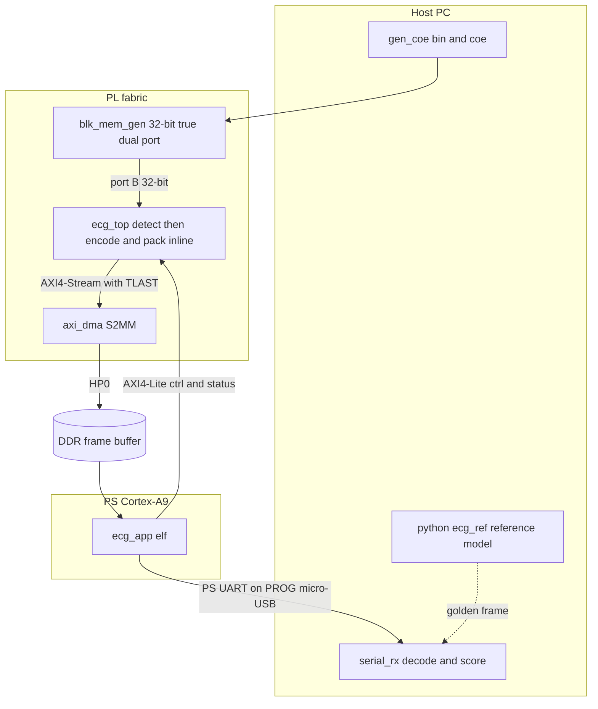
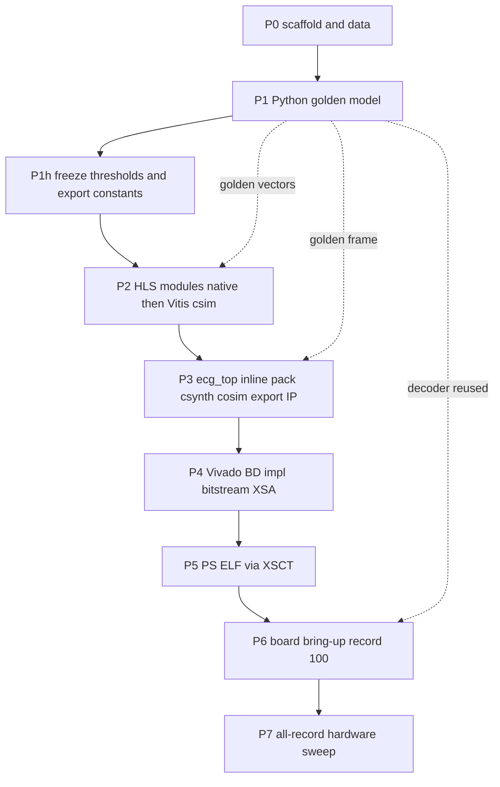

# FPGA Adaptive ECG Compression — Implementation Plan v2

Target: **Zybo Z7-10 (XC7Z010-1CLG400C)**, Vivado **2024.2**/ Vitis / Vitis HLS **2023.2**.

Core strategy: **the Python reference model is the single
source of truth**. It emits golden intermediate vectors and a golden bitstream; every HLS
and hardware step is gated on bit-exact equality against them, so algorithm debugging
happens in numpy rather than in co-simulation or on the board.

---


## 1. Locked specification decisions

These decisions are locked. Everything downstream depends on them.

- RLE token = `[6-bit run (0-63) | 10-bit signed value]`; runs > 63 emit a continuation
tuple `(63, 0)`.
- QRS window = 73 samples inclusive (`R-29 .. R+43`); `WS = 73` in the Golomb divisor and
every buffer.
- Rice parameter `k = max(0, floor(log2(S / count)))` where `S = Σ M(e)` over mapped
residuals and `count` is the real coded residual count (below 73 when consecutive beats
truncate a window).
- Records: MLII-bearing MIT-BIH records only (skip 102 and 104), first 108,000 samples.
- PRD/CR are measured against the **int16 signal loaded into BRAM**, not pre-quantisation
floats, so "PRD = 0% on QRS" means exact reconstruction of that int16 signal.
- Detection bandpass is a **first-order shift-based IIR** (LP ~ fs/8, HP ~ fs/32), not a
Butterworth: it only identifies regions, and it costs no DSP48.
- Haar uses `INV_SQRT2 = 23170` with arithmetic-shift floor semantics, identical in Python
and HLS; the transform is a reversible lifting scheme.
- Band thresholds are **global and frozen**, never per-record.


## 2. Frozen constants 

All of these live in `[python/ecg_ref/config.py](../python/ecg_ref/config.py)` and are
exported to `[hls/src/ecg_constants.h](../hls/src/ecg_constants.h)` by
`[export_hls_constants.py](../python/scripts/export_hls_constants.py)`. Never hand-edit the
header.


| Constant            | Value                               | Note                                                            |
| ------------------- | ----------------------------------- | --------------------------------------------------------------- |
| `FS` / `N_SAMPLES`  | 360 Hz / 108,000                    | 5 minutes per record                                            |
| Band thresholds     | A4=24, D4=64, D3=64, D2=160, D1=160 | Calibrated set from the population sweep, not hand-picked       |
| `MAX_LOSSY_SEGMENT` | 2048                                | Lossy segments are capped and split, not whole-run              |
| `MAX_PEAKS`         | 1502                                | Sized for an unreachable 300 bpm                                |
| `TOKEN_FIFO_DEPTH`  | 128                                 | Module testbenches / packer stage only — `ecg_top` packs inline |
| `MAGIC_WORD`        | `0xEC601001`                        | Frame header word 0                                             |
| UART sync           | `0x45434731` (`ECG1`)               | Transport preamble word 0                                       |
| Preamble / header   | 3 words / 4 words                   | sync, length, latency, then the 128-bit header                  |
| Baud / PL clock     | 115200 8N1 / 100 MHz                |                                                                 |


## 3. Device budget

XC7Z010: **17,600 LUT**, 35,200 FF, 80 DSP48, **60 BRAM36**, **4400 slices**.

Block RAM is the binding resource: the sample store alone is 53 of 60 BRAM36, leaving
about 4 for the IP (57/60 total). Slices are the second constraint — implementation
runs that fail `Place 30-487` have roughly **2647 slices available**, and a slice holds
only one unique control set, so raw LUT count understates how tight packing is. Every
area decision in Phase 3 and Phase 4 exists because of these two numbers.

## 4. Architecture




Decisions baked into that picture:

- `ecg_top` **does not use DATAFLOW.** It runs a detect pass, then a single encode stage
that packs bits onto the AXI4-Stream inline. A DATAFLOW producer/consumer pair with a
token FIFO either overruns block RAM (a 16K-deep BRAM FIFO is ~24 BRAM36 on its own) or
deadlocks in RTL cosim with the packer blocked on `TREADY` while the testbench waits
on `ap_done`. `TOKEN_FIFO_DEPTH = 128` applies only to the module testbenches and the
standalone packer stage.
- **The 128-bit frame header is built on the PS**, not in the PL. Its last word is a
checksum over the whole payload, and a streaming master cannot revisit a header it has
already sent. Buffering the payload on chip to avoid that is not affordable.
- **The sample store is 32 bits on both ports**, two int16 samples per word with sample
2i in the low half. Asymmetric 32/16 true dual port is rejected by the tool flow.
- **Lossy segments are capped** at `MAX_LOSSY_SEGMENT` and split across multiple packets;
the Python model mirrors that split so the bitstream stays bit-exact.
- **One cable.** The compressed frame leaves on the **PS UART**, which is the same PROG
micro-USB Digilent COM port as JTAG and the text log. The `axi_uartlite` on Pmod JE1 is
instantiated in the block design but the firmware never drives it.


## 5. Repo structure

```
ECG_Code/
  python/ecg_ref/      config, preprocess, detect, lossless, lossy, packer,
                       pipeline, metrics, fixedpoint
  python/scripts/      download_mitdb, gen_coe, run_reference, calibrate_thresholds,
                       export_hls_constants, verify_matrix, resource_budget,
                       serial_rx, _bootstrap
  python/tests/        preprocess, detect, lossless, lossy, packer, roundtrip, transport
  data/                mitdb (gitignored), coe/, golden/, reports/
  hls/src/             ecg_types.h, ecg_constants.h (generated), ecg_top, detect,
                       lossless, lossy, bitpack
  hls/tb/              tb_detect, tb_lossless, tb_lossy, tb_packer, tb_top, tb_util.h
  hls/tcl/             common.tcl, module_*.tcl, run_all.tcl, top_integrate.tcl
  hls/shim/            hls_stream_shim.h  (native g++ build only)
  hls/build_native.py  bit-exact g++ gate, no Xilinx tools needed
  vivado/              create_bd.tcl (hand-authored), build_vivado.tcl, constraints/
  ps/                  src/main.c, src/ecg_hw.h, build_ps.tcl, run_hw.tcl
  docs/                this plan, hardware_bringup.md, toolchain_gates.md,
                       verification_matrix.md, resource_budget.md
  testing/             self-contained handoff kit (bit, elf, xsa, host scripts, steps)
```

Two components carry weight in the build order: `hls/build_native.py`
(catches nearly every bit-exactness bug in seconds, before Vitis is involved) and
`export_hls_constants.py` (makes the C header a build artefact of `config.py`).

## 6. Build order and hard sequencing rules




Dependencies that break the build if ignored:

1. `ecg_constants.h` **must be regenerated before any HLS run** whenever `config.py`
  changes. The header is generated, not authored.
2. **Golden vectors must exist before HLS csim**, including a short cosim excerpt;
  `common.tcl` generates the excerpt on demand but needs the Python environment.
3. **IP export (P3) must precede Vivado (P4).** `create_bd.tcl` connects
  `ecg_top_0/ecg_bram_PORTA`; if the exported IP names that interface differently, the
   BD fails loudly and the name must be corrected.
4. **XSA (P4) must precede** `ps/build_ps.tcl` **(P5).** The script errors out if
  `vivado/ecg_zybo.xsa` is missing.
5. **Firmware-only changes need an ELF rebuild only** — no new bitstream. The UART path
  lives entirely in `ps/src/main.c`.
6. **Start** `serial_rx.py` **before** `con`**.** The board transmits once, a few milliseconds
  after the ELF starts.
7. **One process owns the COM port.** A terminal open on the Digilent COM steals the frame.

Parallelisable: the block design skeleton (PS, clocking, BRAM, DMA, resets) can be built
against a stub IP in parallel with P2/P3. Strictly sequential: P1 → P2 → P3, and real IP
integration needs P3's export.

---


## Phase 0 — Scaffolding and data

- Create the layout in §5, `requirements.txt` (numpy, scipy, wfdb, pyserial, matplotlib,
pytest), `.gitignore` for raw data.
- Centralise every constant in `config.py`. Nothing numeric may be duplicated in C++ or
Tcl; the C header is generated from here.
- `download_mitdb.py` fetches records plus `.atr` annotations.
- **Verify:** `pytest` collects; record 100 parses and the MLII channel is identified.


## Phase 1 — Python reference model (the specification)

Build and unit-test each stage in numpy, then dump golden vectors.

- **1a Preprocess** — read `.dat/.hea`, select MLII, 4th-order Butterworth 0.5–40 Hz,
quantise to int16, write `.coe` / `_x32.coe` / `.bin`. The `_x32` variant is the one the
block design loads, and `.bin` is what JTAG writes for record swaps. Verify round-trip
identity on all three and length 108,000.
- **1b Detection** — shift-based IIR bandpass, TKEO, L=18 moving average, adaptive
threshold, `>3x` flag, 72-sample refractory, 73-sample window framing.
**Index alignment is load-bearing:** TKEO needs `bp[n+1]`, so a naive streaming
formulation lands one sample late and silently breaks bit-exactness downstream. Define
the boundary rules here and mirror them exactly in HLS. Verify against `.atr`
(sensitivity/PPV) and with a consecutive-fast-beat truncation test.
- **1c Lossless** — 2nd-order predictor, zigzag map, adaptive `k`, Golomb-Rice encode and
decode. Verify encode∘decode identity, `S = 0 → k = 0` (no `log2(0)`), max-amplitude
residuals, single-sample and truncated windows.
- **1d Lossy** — 4-level Haar lifting, band thresholding, RLE, inverse DWT. Verify the
`(63,0)` continuation, the 10-bit clip rule, pad-to-multiple-of-16, and **segment
splitting at** `MAX_LOSSY_SEGMENT` — the split is part of the bitstream definition, not
a hardware detail.
- **1e Packer** — bit writer/reader, 128-bit header, tagged packets, 32-bit alignment,
additive checksum, TLAST semantics.
- **1f Pipeline and metrics** — full encode → decode → reconstruct; CR and PRD (overall
and QRS-only); emit `data/golden/<rec>/`.
- **1g Fixed-point mirror** (`fixedpoint.py`) — integer helpers that define the exact
truncation and shift semantics HLS must reproduce. Python `//` floors; C `/` truncates
toward zero, so floor-division and high-product helpers are specified here and mirrored
by `ecg_floor_div` / `ecg_mulhi_u64` in `ecg_types.h`.
- **1h Freeze thresholds** — `calibrate_thresholds.py` sweeps `{A4, D4, D3, D2, D1}` across
the whole population and freezes one set (see §2). Then run
`export_hls_constants.py` so the C header matches.
- **Gate:** record 100 hits PRD = 0% on QRS, overall PRD < 2%, CR > 5; decoder round-trip
is identity; 46/46 records pass with the frozen set.


## Phase 2 — HLS modules, bit-exact against golden

Port each module to C++ with HLS types. Every testbench loads golden inputs and asserts
bit-exact golden outputs. All work is Tcl-driven; no GUI.

- Files: `ecg_types.h`, then `detect`, `lossless`, `lossy`, `bitpack` plus `tb_*.cpp`.
`tb_util.h` provides `pack_bram()`, which **always pads to** `ECG_N_BRAM_WORDS` — see
Phase 3 for why a short buffer corrupts cosim.
- **Run the native gate first:** `python hls/build_native.py --records 100 101 119 203 208 233`.
It compiles the synthesisable sources under g++ with only `hls::stream` shimmed. This is
the fast inner loop and catches essentially every arithmetic divergence.
- **Tcl automation:** one `module_<name>.tcl` per module plus `run_all.tcl`, invoked as
`vitis_hls -f hls/tcl/run_all.tcl [-tclargs <record>]`.
**Argument parsing is a trap:** when Vitis launches with `-f <script>`, Tcl's `::argv`
still contains the tool's own `-f` and the script path. `common.tcl` must accept only a
non-flag, non-`.tcl` token as the record id, otherwise csim looks for `data/golden/-f/`.
- **AXI stream typing:** the output stream must be a real AXI side-channel type
(`hls::axis` / `ap_axiu`), not a plain struct, or TLAST does not synthesise and the DMA
can drop bytes. The packer holds one word back so TLAST lands on the genuine last word
without buffering the payload.
- Module tops are named `ecg_encode_qrs_top` / `ecg_encode_nonqrs_top` so that the
synthesisable entry points stay separate from the inlined internal functions.
- **Verify:** per-module csim bit-exact on record 100 plus diverse records (fast HR, noisy,
ectopic); TLAST asserted exactly once; Phase 1 edge cases re-asserted in C++.


## Phase 3 — `ecg_top` integration, synthesis, cosim, IP export

This is where the area and cosim work lives. Driven by
`[hls/tcl/top_integrate.tcl](../hls/tcl/top_integrate.tcl)`.

**Structure:** detection pass first (the exclusive reader of the sample BRAM for that
pass), then one `ecg_encode_stage` that walks the record and packs inline onto the AXIS
port. No DATAFLOW, no on-chip token FIFO on this path.

**Interfaces:**

```c
#pragma HLS INTERFACE bram port = ecg_bram depth = ECG_N_BRAM_WORDS
#pragma HLS INTERFACE axis port = out_stream
#pragma HLS INTERFACE s_axilite port = n_samples bundle = ctrl
#pragma HLS INTERFACE s_axilite port = status   bundle = ctrl
#pragma HLS INTERFACE s_axilite port = return   bundle = ctrl
```

The explicit `depth` is mandatory. **C-sim passes with or without it; cosim does not.**
C-sim calls `ecg_top` with the testbench's real array pointer, so the whole sample store
is valid. Cosim's wrapc adapter allocates its *own* BRAM model for pointer/`bram` ports and
copies the full declared depth; without `depth` the stub is undersized, so only a handful
of samples are real and the rest read as garbage — which shows up as too few peaks, mass
coefficient saturation, a wrong oversized bitstream, or a segfault (`COSIM 212-379`). The
matching requirement is that `pack_bram()` pads the testbench buffer to the same depth,
because wrapc copies that full length out of it.

**Area rules — all of these are required, not optional tuning:**


| Rule                                                                                               | Where                       | Why                                                                                                                    |
| -------------------------------------------------------------------------------------------------- | --------------------------- | ---------------------------------------------------------------------------------------------------------------------- |
| No `ALLOCATION` pragmas anywhere                                                                   | all HLS sources             | Ignored (the calls exist only inside child functions) and crash the compiler with `HLS 200-1715` in 2023.2 |
| `#pragma HLS INLINE` on `ecg_encode_qrs` and `ecg_encode_nonqrs`                                   | `lossless.cpp`, `lossy.cpp` | Both share one emit → bitpack body inside the encode stage                                                             |
| Exactly one textual call site for each encoder, selected by a cursor and `next_start` / `next_end` | `ecg_top.cpp`               | Two call sites make HLS duplicate the whole lossy pipeline; csynth reaches 17,630 LUTs, 100% of the device                 |
| `#pragma HLS INLINE off` on `ecg_emit_bits` / `ecg_bitpack_put`                                    | `bitpack.cpp`               | Keeps a single shared packer body                                                                                      |
| `peaks[]` bound to `ram_1p impl = bram`                                                            | `ecg_top.cpp`               | LUTRAM for 1502 x 32 costs ~750 LUTs                                                                                   |
| `config_rtl -reset control`                                                                        | `common.tcl`                | Full datapath resets explode the control-set count                                                                     |
| Detect loop `#pragma HLS PIPELINE II = 2`                                                          | `detect.cpp`                | Buys area; real-time headroom is four orders of magnitude                                                               |


**Cosim** runs against a 30-second excerpt: the full record would take hours and prove
nothing extra. `common.tcl` generates the excerpt's golden vectors if they are missing.

- **Verify:** top csim bit-exact to the golden frame; cosim passes; latency captured
(budget predicts ~832,800 PL cycles); `csynth` BRAM for the IP around 4 blocks; IP
exported to `hls/proj_top/solution1/impl/ip`.


## Phase 4 — Vivado block design, implementation, XSA

The block design is **hand-authored and scripted** in
`[vivado/create_bd.tcl](../vivado/create_bd.tcl)`, sourced by
`[build_vivado.tcl](../vivado/build_vivado.tcl)`. The scripted form is what keeps the
address map locked to the firmware; a GUI-built design exported with `write_bd_tcl` does
not.

**Contents:** Zynq PS with the Digilent board preset, 100 MHz PL clock, `blk_mem_gen`
(true dual port, **32-bit both ports**, initialised from `<record>_x32.coe`), AXI BRAM
controller on port A, `ecg_top` on port B, AXI DMA S2MM into DDR through HP0,
smartconnects for control and the HP path, and `axi_uartlite` (present, unused).

**Address map — fixed, never auto-assigned**, because
`[ps/src/ecg_hw.h](../ps/src/ecg_hw.h)` hard-codes it and a silent re-assignment produces a
design that builds and does nothing:


| Peripheral                         | Base                 |
| ---------------------------------- | -------------------- |
| Sample store (AXI BRAM controller) | `0x40000000`, 256 KB |
| AXI DMA control                    | `0x40400000`         |
| `axi_uartlite` (unused)            | `0x42C00000`         |
| `ecg_top` AXI4-Lite                | `0x43C00000`         |


**Implementation strategies are part of the design, not preferences** — without them the
build fails `Place 30-487`:

```tcl
set_property strategy Flow_AreaOptimized_high [get_runs synth_1]
set_property strategy Area_Explore            [get_runs impl_1]
set_property STEPS.OPT_DESIGN.ARGS.DIRECTIVE ExploreArea [get_runs impl_1]
```

Entry points: `-bd_only` to stop after `validate_bd_design`, `-record <id>` to pick the
`.coe`, `-jobs <n>`, `-board <name>` when the board-file string differs.

- **Verify:** BD validates; WNS ≥ 0 (the script errors out otherwise);
`data/reports/utilization_<record>.rpt` within budget; `vivado/ecg_zybo.xsa` written.


## Phase 5 — PS firmware and host receiver

**Firmware** (`[ps/src/main.c](../ps/src/main.c)`) per run: arm the DMA into the DDR frame
buffer at `0x10000000`, start the core over AXI4-Lite and time it with the A9 global
timer, poll `ap_done`, read the status registers, build the 128-bit header from them, and
push preamble + header + payload out the UART.

**The UART is the PS UART, over the PROG micro-USB.** Concretely:

- Transmit with a loop of `outbyte()`. Do not use `printf`/`fputc`: a stdio layer may
expand `0x0A` to CRLF and corrupt the payload.
- **Quiet window.** Every `xil_printf` for the run goes out *before* the sync word; nothing
reaches the console between the sync word and the last payload byte; a single
`\r\ndone\r\n` follows. One stray log line inside that window lands inside the frame and
the capture is unrecoverable.
- Keep the startup banner — it is how a tester confirms the ELF is alive, and it also
proves stdout is bound to `ps7_uart_1` rather than the UARTLite.
- No UART driver init at all; `ps7_init` has already configured the PS UART.

**Build** with `[ps/build_ps.tcl](../ps/build_ps.tcl)` (`xsct ps/build_ps.tcl`), which
creates a platform from the XSA, adds `hls/src` and any exported HLS driver headers to the
include path, and builds `ps/workspace/ecg_app/Debug/ecg_app.elf`. Two things to know:

- The domain name is tool-version dependent. `standalone_domain` is the common real name;
the script's hardcoded `standalone_ps7_cortexa9_0` may be rejected. Confirm with
`domain list` under an active platform.
- The script deletes and recreates the workspace. For iterative firmware work use
`setws ps/workspace` then `app build -name ecg_app` instead; sources are soft-linked, so
edits to `ps/src` are picked up.

**Host** (`[python/scripts/serial_rx.py](../python/scripts/serial_rx.py)`) resynchronises on
the sync word and stops after the declared length, so leading banner text and the trailing
`done` are ignored by construction. Three sources share one parser: `--port`, `--file`,
`--loopback`.

- **Verify (desktop, no board):** `python python/scripts/serial_rx.py --loopback 100`
reports `BIT-IDENTICAL` and `PASS`.


## Phase 6 — Board bring-up, record 100

**Hardware:** power, **JP5 = JTAG**, one micro-USB in the **PROG** connector. No Pmod JE1
wiring, no second USB-UART adapter. Note the Digilent COM port; close every terminal on it.

**Three debug targets, three different jobs** — this is the single most common source of
confusion:


| Command                         | Target                       |
| ------------------------------- | ---------------------------- |
| `loadhw <xsa>`                  | **APU** (the cluster parent) |
| `fpga -file <bit>`              | **xc7z010** (the fabric)     |
| `ps7_init`, `mwr`, `dow`, `con` | **Cortex-A9 #0**             |


Order of operations, with the host listener already running:

1. `connect`, then `targets` to learn the ids.
2. `loadhw` on the APU. If the session reports `invalid command name "::hsi::open_hw_design"`,
  the shell is XSDB without HSI: use a full Vitis **XSCT** shell, or skip `loadhw` and
   rely on `memmap` in step 4.
3. `fpga -file` on the fabric target.
4. On Cortex-A9 #0: `stop`, `rst -processor`, `source ps7_init.tcl`, `ps7_init`,
  `ps7_post_config`. `ps7_init` and `ps7_post_config` are procedures defined in that file
   — sourcing it is not optional — and `ps7_post_config` is what raises the PS–PL level
   shifters. Then `memmap -addr 0x40000000 -size 0x40000`.
5. `mwr -bin -file <record>.bin 0x40000000 54000`, then `mrd 0x40000000 1` as a read-back
  probe. A blocked write here means the debugger does not yet treat that window as a valid
   PL AXI slave; it is a JTAG memory-map problem, not a block-design problem, and step 4 is
   the fix.
6. `dow ecg_app.elf`, then `con`.

The scripted equivalent is `xsct ps/run_hw.tcl -record 100`, which takes `-bit`, `-elf` and
`-no_program`.

If `targets` shows only `DAP (AHB AP transaction error)` and `xc7z010` with no APU or
Cortex-A9, JTAG is not reaching the PS at all: check power, `JP5 = JTAG`, the PROG cable,
and close Vivado Hardware Manager or any other XSDB session holding the cable.
`[hardware_bringup.md](hardware_bringup.md)` has the full fault tree.

- **Verify:** `serial_rx.py --port <Digilent COM> --record 100 --save capture_100.bin`
reports checksum OK, PRD QRS 0.000%, baseline PRD < 2%, CR > 5, and
`vs golden BIT-IDENTICAL`. Latency is printed in PL cycles.
- **Banner but no frame** means a stale ELF: a build that predates the PS-UART path
transmits on Pmod JE1, so the PROG COM shows the startup text and then nothing. Rebuild
the ELF and re-`dow`.


## Phase 7 — Full-record hardware sweep

Swap records by writing `data/coe/<record>.bin` into the sample store over JTAG — no
re-synthesis, no bitstream patching. `verify_matrix.py --mode hardware --port <COM>`
automates capture, decode and scoring across the population.

- **Verify:** every MLII record byte-identical to golden with the frozen global thresholds;
latency logged per record. A systemic failure triggers one re-run of Phase 1h
calibration, never a per-record edit.

---


## Known Risks / Technical Debt

Workarounds and mitigations rather than root-cause fixes. Each is safe as it stands but
should be understood before changing anything nearby.


| Item                                                                                                                                                         | Why it is debt                                                                                                                                                             | Consequence if ignored                                                        |
| ------------------------------------------------------------------------------------------------------------------------------------------------------------ | -------------------------------------------------------------------------------------------------------------------------------------------------------------------------- | ----------------------------------------------------------------------------- |
| `axi_uartlite` present in the BD and bitstream, driven by nothing                                                                                             | The PS-UART path is confined to firmware to avoid a re-implementation run                                                                                                  | Wasted LUTs and a pin; a reader may think JE1 is live                         |
| Inline packing instead of a working DATAFLOW pipeline                                                                                                        | DATAFLOW + AXIS deadlocks in cosim and a deep FIFO overruns BRAM; the deadlock itself is not root-caused                                                                   | Throughput is left on the table; re-attempting DATAFLOW means re-solving this |
| Detect `II = 2` and the Vivado area strategies                                                                                                               | Area mitigations for a design that is genuinely near the device ceiling                                                                                                    | Any logic growth can re-trigger `Place 30-487`                                |
| `TOKEN_FIFO_DEPTH` and `ecg_pack_stage` exist while the top packs inline                                                                                     | Two code paths for the same job, kept so module testbenches keep working                                                                                                   | A future editor may assume the token path is live in hardware                 |
| Residual `#region agent log` blocks writing `debug-0362fe.log` in `[common.tcl](../hls/tcl/common.tcl)` and `[build_vivado.tcl](../vivado/build_vivado.tcl)` | Debug instrumentation for `Place 30-487` diagnosis that is not fully removed                                                                                               | Harmless, but writes a stray file and clutters the scripts                    |
| Hardcoded `-domain standalone_ps7_cortexa9_0` in `[build_ps.tcl](../ps/build_ps.tcl)`                                                                        | Real platforms often name it `standalone_domain`                                                                                                                           | `app create` fails on a clean rebuild                                         |
| `build_ps.tcl` deletes the whole workspace on every run                                                                                                      | Deliberate (stale-XSA workspaces are a known failure source) but destroys any manual app                                                                                   | A hand-built app disappears; the domain error then recurs                     |
| Skipping `loadhw` and using bare `memmap`                                                                                                                    | Works around an XSDB shell without HSI instead of fixing the environment                                                                                                   | The debugger has no full address map; only the BRAM window is usable          |
| Quiet window + single-owner COM port                                                                                                                         | An operational convention enforced by comments, not by code                                                                                                                | One stray `xil_printf` silently corrupts every capture                        |
| `[docs/resource_budget.md](resource_budget.md)` is stale                                                                                                     | Checked-in table shows the R-peak array in LUTRAM (751 LUTs) and the token FIFO inside `ecg_top`; the script models peaks in BRAM and the FIFO as testbench-only            | Budget read from the doc will not match the code                              |
| `[docs/toolchain_gates.md](toolchain_gates.md)` is stale                                                                                                     | Describes an asymmetric 32/16 sample store and a DATAFLOW region in `ecg_top`                                                                                               | Misleads the next person about what to verify                                 |


## Needs Testing

Nothing below has been confirmed against the current tree. Everything that requires Xilinx
tools or the board is unverified end to end; the Python and native-C++ gates are the only
ones known to pass.

**Vitis HLS — unrun**

- `vitis_hls -f hls/tcl/run_all.tcl` — every module csim passes.
- `vitis_hls -f hls/tcl/top_integrate.tcl` — top csim bit-exact, `csynth` inside the LUT and
BRAM budget (this is the run that confirms the lossy pipeline is not duplicated),
cosim completes on the 30 s excerpt without deadlock, `export_design` produces
`component.xml`.

**Vivado — the area strategies have not been confirmed to clear** `Place 30-487` **on a clean run**

- `-bd_only` validates.
- Full build: WNS ≥ 0, utilisation within budget, `vivado/ecg_zybo.xsa` written.
- Confirm the exported IP's BRAM interface really is named `ecg_top_0/ecg_bram_PORTA`.

**PS firmware — the PS-UART path has never been compiled**

- `xsct ps/build_ps.tcl` produces an ELF (expect the domain-name issue above).
- `outbyte` resolves against this BSP, and the BSP's `STDOUT_BASEADDRESS` is `0xE0001000`
(`ps7_uart_1`), not `0x42C00000` (the UARTLite).

**Board — no run has ever used the PS-UART firmware**

- Banner appears on the Digilent COM at 115200 8N1.
- Record 100 returns `BIT-IDENTICAL` over that port.
- Measured latency is near the ~832,800-cycle prediction.
- `verify_matrix.py --mode hardware` across all 46 records.

**Documentation regeneration**

- `python python/scripts/resource_budget.py --report docs/resource_budget.md` to refresh the
stale table.
- Rewrite the asymmetric-BRAM and DATAFLOW claims in `toolchain_gates.md`.


## Validation checklist

The minimum sequence to prove the system runs, from a clean checkout. Steps 1–3 need no
Xilinx tools and no board.

**1. Environment**

```bash
pip install -r requirements.txt
```

Python 3.11+. No environment variables are required; `python/scripts/_bootstrap.py` puts
`python/` on `sys.path`, so scripts must be run from the repo root. `common.tcl` locates the
interpreter itself for golden-vector generation.

**2. Data and golden artefacts**

```bash
python python/scripts/download_mitdb.py
python python/scripts/gen_coe.py
python python/scripts/run_reference.py 100 --golden
```

Expect `data/mitdb/`, `data/coe/100.coe`, `100_x32.coe`, `100.bin` (216,000 bytes), and
`data/golden/100/`.

**3. Desktop gates (must all pass before touching tools)**

```bash
pytest python/tests
python hls/build_native.py --records 100 101 119 203 208 233
python python/scripts/serial_rx.py --loopback 100
python python/scripts/resource_budget.py
```

Expect: tests green; every native testbench bit-exact; loopback prints `vs golden BIT-IDENTICAL` and `result PASS`; budget reports 57/60 BRAM36.

**4. HLS**

```bash
vitis_hls -f hls/tcl/run_all.tcl
vitis_hls -f hls/tcl/top_integrate.tcl
```

Expect every `csim_design` to pass, `csynth` LUTs comfortably under 17,600 with the IP at
about 4 BRAM36, cosim to finish, and `hls/proj_top/solution1/impl/ip/component.xml` to exist.

**5. Vivado**

```bash
vivado -mode batch -source vivado/build_vivado.tcl -tclargs -bd_only
vivado -mode batch -source vivado/build_vivado.tcl
```

Expect a clean `validate_bd_design`, then WNS ≥ 0 and `vivado/ecg_zybo.xsa`.

**6. Firmware**

```bash
xsct ps/build_ps.tcl
```

Expect `ps/workspace/ecg_app/Debug/ecg_app.elf`. If the domain name is rejected, get the
real one from `domain list` and use it.

**7. Board (one micro-USB in PROG, JP5 = JTAG, no terminal on the COM port)**

Listener first:

```bash
python python/scripts/serial_rx.py --port COM5 --record 100 --save capture_100.bin
```

Then, in a second window:

```bash
xsct ps/run_hw.tcl -record 100
```

**Expected output** from the listener:

```
listening on COM5 at 115200 baud
  resynchronised after N stray byte(s)
received 22684 bytes in 1.8s
  checksum     OK
  CR           9.59
  PRD QRS      0.000%
  vs golden    BIT-IDENTICAL
  result       PASS
```

The stray-byte line is the firmware banner and status lines; it is expected. `PASS` with
`BIT-IDENTICAL` is the whole acceptance criterion — CR and PRD can look plausible while the
hardware is subtly wrong, but a byte-exact match cannot.

**8. Full sweep**

```bash
python python/scripts/verify_matrix.py --mode hardware --port COM5
```

Expect 46/46 byte-identical.

## Milestones


| ID  | Done when                                                                                                 |
| --- | --------------------------------------------------------------------------------------------------------- |
| M0  | Repo runs, record 100 parses, `pytest` collects                                                           |
| M1  | Frozen thresholds; 46/46 reference pass; golden vectors and `.coe` emitted; `ecg_constants.h` regenerated |
| M2  | Native build and Vitis csim bit-exact on six diverse records; TLAST asserted once                         |
| M3  | `ecg_top` csim + cosim bit-exact; csynth within LUT/BRAM budget; IP exported                              |
| M4  | Implementation meets timing and utilisation; XSA exported                                                 |
| M5  | ELF builds; desktop loopback `BIT-IDENTICAL`                                                              |
| M6  | Record 100 on hardware `BIT-IDENTICAL` over the PROG micro-USB; latency measured                          |
| M7  | All MLII records byte-identical on hardware; verification matrix complete                                 |


---

## Provenance

Consolidated from `docs/ECG_plan.md` and `docs/changes_since_ECG_plan.md`, which are kept
for history only and are not authoritative.
